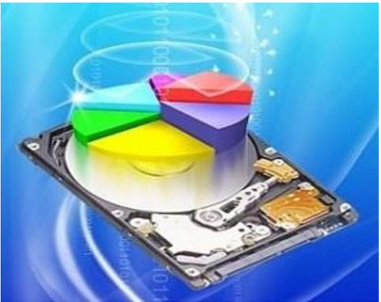
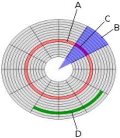

# الوحدة 03: نظام التشغيل — من الإقلاع إلى التثبيت

## المجال المفاهيمي الأول: التعامل مع بيئة الحاسوب

**المستوى:** السنة الأولى ثانوي (1AS)  
**المدة الزمنية:** 04 ساعات (أسبوعان: حصتان نظريتان وحصتان تطبيقيتان)

---

## الأهداف التعلمية

في نهاية هذه الوحدة، يكون المتعلم قادرًا على أن:

1. يعرّف نظام التشغيل (Operating System / *Système d'exploitation*) ويذكر أهم وظائفه.
2. يميّز بين أنظمة تشغيل الحواسيب (Windows، macOS، Linux) وأنظمة تشغيل الهواتف (Android، iOS).
3. يصف مراحل إقلاع الحاسوب ودور البرنامج الثابت UEFI (والاسم القديم BIOS).
4. ينفّذ تغيير **الإقلاع الأول** (Boot order) في برنامج الإعداد، أو يختار وسيط الإقلاع من **قائمة الإقلاع** (Boot menu).
5. يشرح معنى **تقسيم القرص** (Partitioning) و**تهيئته** (Formatting) ويميّز بينهما.
6. يختار نظام الملفات المناسب (NTFS، FAT32، exFAT، ext4) حسب الاستعمال.
7. يرتّب المراحل التي يقترحها برنامج الإعداد أثناء تثبيت نظام التشغيل.
8. يثبّت نظام تشغيل داخل **آلة افتراضية** باستعمال برنامج محاكاة (VirtualBox)، دون أي خطر على الحاسوب الحقيقي.

---

## خريطة التعلم في أربع حصص

| الحصة | السؤال المركزي | ناتج التعلّم القابل للملاحظة |
|---|---|---|
| 1 — نظري (الأسبوع 1) | ما الذي يجعل العتاد الذي جمعناه حاسوبًا يعمل؟ | يذكر أربع وظائف لنظام التشغيل ويصنّف أنظمة معروفة. |
| 2 — تطبيقي (الأسبوع 1) | كيف يختار الحاسوب من أين يُقلع؟ | يحدّد ترتيب الإقلاع في آلة افتراضية ويُعدّها للتثبيت. |
| 3 — نظري (الأسبوع 2) | كيف نُحضّر القرص لاستقبال النظام؟ | يميّز بين التقسيم والتهيئة ويرتّب مراحل التثبيت. |
| 4 — تطبيقي (الأسبوع 2) | كيف يجري تثبيت حقيقي خطوة بخطوة؟ | يُكمل تثبيت نظام في الآلة الافتراضية ويوثّق مراحله. |

> **فكرة الوحدة:** في الوحدة 02 جمعنا **العتاد**. لكن حاسوبًا بلا نظام تشغيل يشبه سيارة جديدة بلا سائق: كل القطع موجودة، ولا أحد ينسّق بينها. في هذه الوحدة نتعرّف على هذا «السائق»، وكيف نُدخله إلى الحاسوب أول مرة.

---

## 1. ما هو نظام التشغيل؟

### أ. التعريف

**نظام التشغيل** (Operating System / *Système d'exploitation*) مجموعة من البرامج المتكاملة التي تُدير عتاد الحاسوب وبرامجه، وتشكّل **الوسيط** بين المستخدم والجهاز. هو أول برنامج كبير يُشحن في الذاكرة عند تشغيل الحاسوب، وآخر برنامج يتوقف عند إطفائه.

```
المستخدم  ⇄  التطبيقات (متصفح، معالج نصوص، ألعاب)  ⇄  نظام التشغيل  ⇄  العتاد (معالج، ذاكرة، قرص، شاشة)
```

لا يخاطب التطبيق العتادَ مباشرة: عندما تضغط **طباعة** في معالج النصوص، يطلب البرنامج ذلك من نظام التشغيل، وهو الذي يتعامل مع الطابعة عبر **برنامج التعريف** (Driver / *Pilote*) الخاص بها.

### ب. وظائف نظام التشغيل

| الوظيفة | ماذا يفعل؟ | مثال من حياتك |
|---|---|---|
| **إقلاع الحاسوب وتهيئته للعمل** | يُشحن بعد البرنامج الثابت ويُجهّز الأجهزة والخدمات | ظهور شاشة تسجيل الدخول بعد التشغيل |
| **إدارة المعالج** | يوزّع وقت المعالج بين البرامج المفتوحة (تعدد المهام / Multitasking) | تستمع إلى الموسيقى وأنت تكتب بحثك |
| **إدارة الذاكرة** | يمنح كل برنامج جزءًا من RAM ويسترجعه عند إغلاقه | إغلاق برنامج ثقيل يجعل الجهاز أسرع |
| **إدارة الملفات والتخزين** | ينظّم الملفات في مجلدات وأقراص ويتحكم في القراءة والكتابة | مستكشف الملفات، القرص C: |
| **إدارة الأجهزة الملحقة** | يتعرّف على الأجهزة ويشغّلها عبر برامج التعريف | إدخال ذاكرة USB فتظهر بعد ثوانٍ |
| **توفير واجهة الاستخدام** | واجهة بيانية (GUI) بالنوافذ والأيقونات، أو سطر أوامر | قائمة ابدأ، شاشة اللمس في الهاتف |
| **الأمان والحسابات** | يحمي الملفات بكلمات المرور والصلاحيات | حساب مسؤول وحساب قياسي (الوحدة 04) |
| **تشغيل التطبيقات** | يوفّر للبرامج «أرضية» تعمل فوقها | تطبيق صُمّم لـ Windows لا يعمل مباشرة على Android |

### ج. أنواع أنظمة التشغيل وأمثلتها

| الفئة | أمثلة حالية | ملاحظة |
|---|---|---|
| **أنظمة الحواسيب** (مكتبي ومحمول) | Windows 11، macOS، توزيعات Linux مثل Ubuntu وDebian وLinux Mint، ChromeOS | macOS نظام حواسيب Mac من Apple، وليس نظام هواتف |
| **أنظمة الهواتف والألواح** | Android، iOS (هاتف iPhone)، iPadOS (لوح iPad) | Android مبني على نواة Linux |
| **أنظمة الخوادم** (إثراء) | Windows Server، Linux | تشغّل المواقع والخدمات السحابية |
| **أنظمة مدمجة** (إثراء) | أنظمة التلفاز الذكي والساعات والسيارات | مخفية داخل الأجهزة اليومية |

> **تحديث عن الكتاب المدرسي (2015):** أنظمة مثل **Windows Phone** و**BlackBerry OS** و**IBM OS/2** توقفت ولم تعد مستعملة. وكان **Mac OS** مذكورًا خطأً بين أنظمة الهواتف؛ الصحيح أنه نظام حواسيب، وأنظمة Apple للهواتف والألواح هي iOS وiPadOS.

### د. أنظمة مملوكة وأنظمة حرة

- **نظام مملوك** (Proprietary): تملكه شركة وتبيع رخصة استعماله، مثل **Windows** (Microsoft) و**macOS** (Apple).
- **نظام حر ومفتوح المصدر** (Open source / *Logiciel libre*): يمكن تنزيله واستعماله مجانًا والاطلاع على شفرته، مثل **Ubuntu** و**Debian**.

---

## 2. كيف يُقلع الحاسوب؟

### أ. مراحل الإقلاع

**الإقلاع** (Boot / *Démarrage*) هو سلسلة العمليات من الضغط على زر التشغيل إلى ظهور شاشة الدخول:

1. **التشغيل:** يصل التيار إلى اللوحة الأم.
2. **البرنامج الثابت يعمل:** يُنفَّذ **UEFI** المخزّن في ذاكرة اللوحة الأم (رأيناها في الوحدة 02 باسم ROM/UEFI).
3. **الفحص الذاتي** (POST): يتحقق من المعالج والذاكرة وبطاقة العرض ولوحة المفاتيح.
4. **البحث عن وسيط الإقلاع:** يقرأ **ترتيب الإقلاع** (Boot order) ويبحث عن نظام في أول وسيط: SSD، أو ذاكرة USB، أو الشبكة...
5. **شحن نظام التشغيل:** يُنقل النظام من القرص إلى RAM ويتولى إدارة الجهاز.
6. **شاشة تسجيل الدخول:** يصبح الحاسوب جاهزًا للمستخدم.

### ب. UEFI وBIOS: البرنامج الثابت

**البرنامج الثابت** (Firmware / *Micrologiciel*) برنامج صغير مخزّن في شريحة على اللوحة الأم، يعمل **قبل** نظام التشغيل.

| | BIOS (Basic Input/Output System) | UEFI (Unified Extensible Firmware Interface) |
|---|---|---|
| الحالة | الاسم القديم، في الأجهزة السابقة لـ 2012 تقريبًا | المعيار الحديث في كل الأجهزة الحالية |
| الواجهة | نصّية بلوحة المفاتيح فقط | غالبًا بيانية وتدعم الفأرة |
| الأقراص | يقلع من أقراص MBR | يقلع من أقراص GPT الكبيرة |
| الحماية | محدودة | **الإقلاع الآمن** (Secure Boot) |

> **ملاحظة لغوية:** ما زال كثير من الناس يسمّون شاشة UEFI «البيوس» (BIOS)، وتظهر الكلمة في بعض الأجهزة الحديثة أيضًا. حين تسمعها، اعلم أن المقصود هو **برنامج الإعداد** (Setup) الخاص بالبرنامج الثابت.

### ج. شروط Windows 11 المرتبطة بالبرنامج الثابت

لا يُثبَّت Windows 11 رسميًا إلا على جهاز يوفّر:

- **UEFI مع إمكانية الإقلاع الآمن** (Secure Boot): يسمح بالإقلاع فقط ببرامج موقّعة وموثوقة، فيمنع برامج خبيثة من التسلل قبل النظام.
- **شريحة TPM 2.0** (Trusted Platform Module): «خزنة» صغيرة في الجهاز تحفظ مفاتيح التشفير ورموز الحماية.
- إضافة إلى معالج متوافق، و**4 GB** من RAM على الأقل، و**64 GB** من التخزين على الأقل.

> لهذا السبب لا يمكن تثبيت Windows 11 رسميًا على بعض الحواسيب القديمة التي تعمل جيدًا بـ Windows 10 أو 8.1.

---

## 3. تغيير الإقلاع الأول في برنامج الإعداد

### أ. لماذا نغيّر ترتيب الإقلاع؟

يُقلع الحاسوب عادة من قرصه الداخلي (SSD أو HDD). لتثبيت نظام جديد، يجب أن يُقلع من **وسيط التثبيت**، وهو اليوم **ذاكرة USB قابلة للإقلاع** (Bootable USB) تحتوي على **صورة ISO** للنظام. (كانت الأقراص المضغوطة CD/DVD تُستعمل سابقًا، ولم تعد معظم الحواسيب الحديثة تحتوي على قارئ لها.)

> **صورة ISO** (ISO image): ملف واحد يحمل نسخة كاملة من قرص التثبيت. نُنزّله من الموقع الرسمي للنظام، ثم ننقله إلى ذاكرة USB بأداة خاصة تجعلها قابلة للإقلاع.

### ب. طريقتان للإقلاع من ذاكرة USB

| الطريقة | متى نستعملها؟ | ماذا نفعل؟ |
|---|---|---|
| **قائمة الإقلاع** (Boot menu) | لإقلاع مرة واحدة دون تغيير دائم | نضغط مفتاحًا خاصًا فور التشغيل ونختار ذاكرة USB من القائمة |
| **برنامج الإعداد** (UEFI Setup) | لتغيير الترتيب بشكل دائم | ندخل الإعداد، ونضع USB في المرتبة الأولى، ثم **نحفظ ونخرج** |

**خطوات تغيير الإقلاع الأول في برنامج الإعداد:**

1. أدخل ذاكرة USB القابلة للإقلاع.
2. شغّل الحاسوب واضغط مباشرة وبشكل متكرر على مفتاح الدخول إلى الإعداد.
3. ابحث عن قسم **الإقلاع** (Boot) ثم عن **ترتيب الإقلاع** (Boot order / Boot priority).
4. ضع ذاكرة USB في المرتبة الأولى.
5. اختر **الحفظ والخروج** (Save & Exit) — غالبًا بالمفتاح `F10`، ويُذكر المفتاح الصحيح في أسفل الشاشة.
6. يعيد الحاسوب التشغيل ويُقلع من ذاكرة USB.

### ج. المفاتيح تختلف من صانع لآخر

لا يوجد مفتاح موحّد، فهو يختلف حسب صانع الجهاز أو اللوحة الأم، ويظهر عادة لثوانٍ على الشاشة الأولى. أمثلة شائعة:

| الغاية | مفاتيح شائعة |
|---|---|
| الدخول إلى برنامج الإعداد | `Del` (Suppr) أو `F2`، وأحيانًا `F1` أو `F10` أو `Esc` |
| فتح قائمة الإقلاع | `F12` أو `F11` أو `F9` أو `F8` أو `Esc` |

> **طريقة من داخل Windows 11:** إن كان الإقلاع سريعًا جدًا ولم تلحق بالضغط، استعمل: **الإعدادات ← النظام ← الاسترداد ← بدء التشغيل المتقدم**، ثم اختر الدخول إلى إعدادات البرنامج الثابت UEFI.

> **قاعدة سلامة:** لا تغيّر في برنامج الإعداد إلا ما طُلب منك. إعدادات أخرى (مثل إيقاف الإقلاع الآمن أو تغيير وضع القرص) قد تمنع النظام من الإقلاع. في المخبر، يُنفَّذ هذا النشاط داخل الآلة الافتراضية أو يعرضه الأستاذ.

---

## 4. تقسيم القرص وتهيئته

### أ. تشبيه للفهم: الخزانة الجديدة

تخيّل أنك اشتريت **خزانة كبيرة فارغة** لغرفتك:

- **التقسيم** = تركيب **رفوف وحواجز** تجعل الخزانة أجزاء منفصلة: جزء للكتب، وجزء للملابس.
- **التهيئة** = تجهيز كل جزء بـ **نظام ترتيب**: علب مرقّمة ودفتر فهرس يدلّك أين وضعت كل شيء.
- **إعادة التهيئة** = تفريغ الجزء وإعادة ترتيبه من البداية: **كل ما كان فيه يضيع**.

### ب. تقسيم القرص (Partitioning / *Partitionnement*)

القرص قطعة واحدة ماديًا، لكن يمكن **تقسيمه منطقيًا** إلى أجزاء مستقلة تسمى **التجزئات** (Partitions). في Windows تظهر كل تجزئة كقرص منفصل بحرف: `C:` و`D:`...



**فوائد التقسيم:**

- فصل **النظام** (`C:`) عن **الملفات الشخصية** (`D:`): إذا أعدنا تثبيت النظام تبقى الملفات سليمة.
- تنظيم أفضل للبيانات.
- إمكانية تثبيت **نظامين** على الحاسوب نفسه (مثلًا Windows وUbuntu).

> **ملاحظة:** عند تثبيت Windows 11 على قرص فارغ، ينشئ برنامج الإعداد تلقائيًا تجزئات صغيرة إضافية (تجزئة الإقلاع EFI وتجزئة الاسترداد Recovery). هي ضرورية لعمل النظام، فلا تحذفها.

**جدول التقسيم: MBR أم GPT؟** يُكتب في بداية كل قرص «فهرس» يصف تجزئاته:

| | MBR (النمط القديم) | GPT (المعيار الحديث) |
|---|---|---|
| حجم القرص | حتى 2 TB | أكبر بكثير |
| عدد التجزئات | 4 تجزئات أساسية | حتى 128 تجزئة في Windows |
| البرنامج الثابت | BIOS القديم | **UEFI** — وهو المطلوب لـ Windows 11 |

### ج. تهيئة القرص (Formatting / *Formatage*)

**التهيئة** هي تجهيز تجزئة لتخزين الملفات بكتابة **نظام ملفات** (File system / *Système de fichiers*) عليها؛ وهو الطريقة التي يسجّل بها النظام أماكن الملفات وأسماءها وأحجامها.

| نظام الملفات | أين يُستعمل؟ | ميزة أو حدّ |
|---|---|---|
| **NTFS** | قرص Windows الداخلي | يدعم الملفات الكبيرة والصلاحيات؛ قد لا تقرؤه بعض الأجهزة الأخرى |
| **FAT32** | ذاكرات USB وبطاقات الذاكرة القديمة | تقرؤه كل الأجهزة تقريبًا، لكن **لا يقبل ملفًا أكبر من 4 GB** |
| **exFAT** | ذاكرات USB وبطاقات الذاكرة الحديثة | يقبل الملفات الكبيرة ومتوافق مع Windows وmacOS ومعظم الهواتف |
| **ext4** | Linux (مثل Ubuntu) | نظام الملفات الافتراضي في كثير من توزيعات Linux |

**تهيئة سريعة أم كاملة؟**

- **التهيئة السريعة** (Quick format): تكتب نظام ملفات جديدًا وتُفرغ «الفهرس» فقط؛ تستغرق ثوانٍ.
- **التهيئة الكاملة** (Full format): تفحص أيضًا كل القرص بحثًا عن الأجزاء التالفة؛ تستغرق وقتًا أطول بكثير.

> **تحذير:** التهيئة — سريعة كانت أو كاملة — **تمحو محتوى التجزئة**. قبل أي تهيئة: تأكّد من حرف القرص الصحيح، وانسخ ملفاتك المهمة احتياطيًا.

**حالة واقعية:** صديقك نسخ فيلمًا حجمه 6 GB إلى ذاكرة USB، فظهرت رسالة «الملف كبير جدًا» رغم وجود مساحة فارغة كافية. السبب: الذاكرة مهيّأة بـ **FAT32**. الحل: نسخ ملفاته الأخرى ثم تهيئتها بـ **exFAT**.

**كيف نهيّئ ذاكرة USB في Windows 11؟** مستكشف الملفات ← هذا الكمبيوتر ← نقر بالزر الأيمن على الذاكرة ← **تهيئة** (Format) ← اختيار نظام الملفات وتسمية الوحدة ← تهيئة سريعة ← بدء.

### د. الفرق بين التقسيم والتهيئة

| وجه المقارنة | التقسيم (Partitioning) | التهيئة (Formatting) |
|---|---|---|
| السؤال الذي يجيب عنه | **كم** جزءًا في القرص؟ وما حجم كل جزء؟ | **كيف** تُنظَّم الملفات داخل الجزء؟ |
| ما يُكتب على القرص | جدول التجزئات (MBR أو GPT) | نظام الملفات (NTFS، exFAT، ext4...) |
| الترتيب | يأتي **أولًا** | يأتي **بعد** التقسيم، لكل تجزئة على حدة |
| النتيجة | أجزاء بأحرف أو أسماء مختلفة | جزء جاهز لاستقبال الملفات |
| أداة في Windows | **إدارة الأقراص** (Disk Management) | مستكشف الملفات أو إدارة الأقراص |

> **أداة للاكتشاف:** في Windows افتح **إدارة الأقراص** بـ `Win + X` ثم «إدارة الأقراص». سترى كل قرص وتجزئاته ونظام ملفات كل تجزئة. **في المخبر: نلاحظ فقط ولا نغيّر شيئًا.**

### هـ. إثراء: التهيئة منخفضة المستوى

كان الكتاب المدرسي يميّز بين نوعين من التهيئة:

- **التهيئة الفيزيائية** أو منخفضة المستوى (Low-level formatting): تقسيم سطح القرص المغناطيسي HDD إلى **مسارات** (Tracks / *Pistes*) و**قطاعات** (Sectors / *Secteurs*). تُنجَز **في المصنع** ولا يقوم بها المستخدم.
- **التهيئة المنطقية** أو عالية المستوى (High-level formatting): كتابة نظام الملفات، وهي «التهيئة» التي نقصدها في هذه الوحدة.



> هذا التقسيم إلى مسارات دائرية خاص بالأقراص الميكانيكية HDD. أقراص SSD لا تدور ولا تحتوي على مسارات، لكنها تُقسَّم وتُهيَّأ منطقيًا بالطريقة نفسها.

---

## 5. تثبيت نظام التشغيل

### أ. ما هو التثبيت؟

**التثبيت** (Installation) هو نسخ ملفات نظام التشغيل من وسيط التثبيت إلى القرص الداخلي وإعدادها لتعمل بشكل دائم. يتولاه برنامج خاص يسمى **برنامج الإعداد** أو **المثبِّت** (Setup / Installer) يقترح علينا مراحل نتبعها بالترتيب.

**متى نحتاج إلى تثبيت نظام؟** حاسوب جديد بقرص فارغ، أو تغيير القرص المعطّل، أو نظام أصابه عطل كبير أو برنامج خبيث، أو إعادة تجهيز حواسيب المخبر في بداية السنة.

### ب. قبل التثبيت: قائمة التحقق

- **نسخ احتياطي** لكل الملفات المهمة (التثبيت النظيف يمحو التجزئة).
- التحقق من **متطلبات النظام** (المعالج، RAM، التخزين، TPM 2.0 وSecure Boot لـ Windows 11).
- تجهيز **ذاكرة USB قابلة للإقلاع** من الموقع الرسمي (8 GB على الأقل لـ Windows 11).
- تجهيز **مفتاح المنتج** (Product key) إن وُجد، أو التأكّد أن الرخصة مرتبطة بالجهاز.
- توصيل الحاسوب المحمول **بالشاحن** حتى لا تنقطع العملية.
- تغيير **الإقلاع الأول** إلى ذاكرة USB أو استعمال قائمة الإقلاع (القسم 3).

### ج. مراحل التثبيت التي يقترحها برنامج إعداد Windows 11

قد يختلف شكل الشاشات وترتيبها قليلًا من إصدار لآخر، لكن المراحل الأساسية هي:

**المرحلة الأولى: برنامج الإعداد (من ذاكرة USB)**

1. **اختيار اللغة والمنطقة:** لغة التثبيت، وتنسيق الوقت والعملة، ولوحة المفاتيح.
2. **بدء التثبيت:** اختيار تثبيت Windows (لا الإصلاح).
3. **مفتاح المنتج:** إدخاله، أو تخطّي هذه الخطوة وتفعيل النظام لاحقًا.
4. **اختيار الإصدار** (Edition): مثل Home أو Pro، حسب الرخصة المتوفرة.
5. **الموافقة على شروط الترخيص** (License terms).
6. **نوع التثبيت:** تثبيت جديد (مخصّص / Custom) على قرص فارغ أو تجزئة، وليس ترقية نظام موجود.
7. **اختيار موضع التثبيت:** تظهر الأقراص والتجزئات؛ يمكن هنا **إنشاء** تجزئة أو **حذفها** أو **تهيئتها**، ثم نختار التجزئة التي سيُثبَّت عليها النظام.
8. **نسخ الملفات وتثبيتها:** يعمل البرنامج وحده، ويُعيد تشغيل الحاسوب عدة مرات. **لا تُطفئ الجهاز** في هذه المرحلة.

**المرحلة الثانية: إعداد الاستعمال الأول (OOBE — Out-of-Box Experience)**

9. **البلد أو المنطقة**، ثم **تخطيط لوحة المفاتيح** وإمكانية إضافة تخطيط ثانٍ (العربية والفرنسية مثلًا).
10. **الاتصال بالشبكة** (Wi-Fi أو كبل)؛ وتشترطه بعض الإصدارات لإكمال الإعداد.
11. **اسم الجهاز** في بعض الإصدارات.
12. **حساب المستخدم:** حساب Microsoft غالبًا، مع إنشاء **رمز PIN**؛ وتتيح بعض الحالات حسابًا محليًا.
13. **إعدادات الخصوصية:** الموقع، والبيانات التشخيصية، والإعلانات... اقرأها واختر بوعي.
14. **الوصول إلى سطح المكتب:** يكتمل التثبيت، ثم نُعيد ترتيب الإقلاع إلى القرص الداخلي إن لزم ونُجري **تحديثات Windows**.

> **قارن مع الكتاب المدرسي:** المراحل الكبرى نفسها بقيت (اللغة، الشروط، موضع التثبيت، المستخدم وكلمة المرور، المنطقة الزمنية، الشبكة)، لكن الوسيط أصبح ذاكرة USB، وأُضيفت مراحل الحساب والخصوصية، ويُضبط الوقت تلقائيًا عبر الإنترنت.

### د. وماذا عن Ubuntu؟

مُثبِّت Ubuntu يسير بالمنطق نفسه: اللغة ← لوحة المفاتيح ← الشبكة ← نوع التثبيت ← **إعداد القرص** (محو القرص وتثبيت Ubuntu، أو تقسيم يدوي) ← إنشاء الحساب (الاسم، اسم الجهاز، كلمة المرور) ← المنطقة الزمنية ← مراجعة الاختيارات ← التثبيت ← إعادة التشغيل. ويُهيّئ تجزئته عادة بنظام الملفات **ext4**.

---

## 6. نشاط تطبيقي: تثبيت نظام في آلة افتراضية

### أ. ما هو برنامج المحاكاة؟

**الآلة الافتراضية** (Virtual Machine / *Machine virtuelle*) «حاسوب داخل الحاسوب»: برنامج يقتطع جزءًا من المعالج والذاكرة والقرص الحقيقي ليصنع منه حاسوبًا وهميًا له UEFI خاص به وقرص افتراضي (ملف كبير). كل ما نفعله داخله — تقسيم، تهيئة، تثبيت — **لا يمسّ** الحاسوب الحقيقي.

نستعمل **VirtualBox** (برنامج محاكاة مجاني من Oracle)، ونثبّت فيه **Ubuntu** (مجاني)؛ ويمكن للأستاذ عرض تثبيت **Windows 11** بنسخة تقييمية (Evaluation) على جهاز العرض.

**التجهيزات اللازمة (يحضّرها الأستاذ أو مسؤول المخبر مسبقًا):** VirtualBox مثبّت، وملف ISO منسوخ على كل جهاز، ومساحة فارغة لا تقل عن 25 GB تقريبًا، و8 GB من RAM في الحاسوب الحقيقي للعمل براحة، وتفعيل خاصية المحاكاة في المعالج (VT-x أو AMD-V) من برنامج الإعداد UEFI.

### ب. الحصة الثانية: تحضير الآلة الافتراضية

| المهمة | ما يجب إنجازه | مؤشر النجاح |
|---|---|---|
| 1 | إنشاء آلة جديدة باسم «تثبيت_اسمك»، واختيار ملف ISO | الآلة تظهر في قائمة VirtualBox |
| 2 | **إلغاء التثبيت التلقائي** (Unattended installation) حتى نرى المراحل بأنفسنا | يظهر برنامج الإعداد عند التشغيل لا تثبيت آلي |
| 3 | تخصيص الذاكرة (4 GB إن أمكن) ومعالجين، وقرص افتراضي بحجم 25 GB | ملخّص الإعدادات صحيح قبل الإنهاء |
| 4 | فتح إعدادات الآلة ← **النظام** ← **ترتيب الإقلاع**، ومقارنته بترتيب UEFI الحقيقي | يشرح شفويًا من أين ستُقلع الآلة ولماذا |
| 5 | تشغيل الآلة والتأكد من ظهور شاشة برنامج الإعداد ثم إيقافها | لقطة شاشة لأول نافذة في المثبّت |

### ج. الحصة الرابعة: التثبيت الكامل

| المهمة | ما يجب إنجازه | مؤشر النجاح |
|---|---|---|
| 1 | تشغيل الآلة واتباع المراحل: اللغة، لوحة المفاتيح، الشبكة | يصل إلى مرحلة إعداد القرص |
| 2 | في إعداد القرص: اختيار محو القرص والتثبيت (القرص الافتراضي فقط) | يذكر أن القرص الحقيقي لم يتأثر ولماذا |
| 3 | إنشاء حساب: اسم مستعار، اسم جهاز، كلمة مرور تجريبية | الحساب يقبل الدخول بعد إعادة التشغيل |
| 4 | ملء **بطاقة توثيق المراحل** أثناء الانتظار: رقم المرحلة، اسمها، ما اخترته | بطاقة مكتملة بالترتيب الصحيح |
| 5 | بعد الدخول: البحث عن «Disks» (الأقراص) وملاحظة التجزئات ونظام الملفات ext4 | يذكر تجزئة واحدة على الأقل ونظام ملفاتها |

> **إذا كانت حواسيب المخبر ضعيفة أو لا تدعم المحاكاة:** يعرض الأستاذ التثبيت على جهازه عبر جهاز العرض، ويملأ التلاميذ بطاقة التوثيق؛ ثم يُنجزون **نشاط بطاقات الترتيب**: بطاقات مكتوب على كل منها مرحلة (تغيير الإقلاع الأول، اختيار اللغة، الموافقة على الترخيص، اختيار التجزئة، التهيئة، نسخ الملفات، إنشاء الحساب، الخصوصية...)، يرتّبها كل فوج على الطاولة ويبرّر ترتيبه.

---

## تقويم ختامي للوحدة

1. **الوظائف:** اذكر **أربع** وظائف لنظام التشغيل، مع مثال لكل وظيفة.
2. **التصنيف:** صنّف في جدول: Android، Windows 11، macOS، iOS، Ubuntu. أي هذه الأنظمة حرّ ومجاني؟
3. **الإقلاع الأول:** تريد تثبيت نظام من ذاكرة USB، لكن الحاسوب يُقلع دائمًا من قرصه الداخلي. اشرح بالترتيب كيف تغيّر الإقلاع الأول في برنامج الإعداد. ولماذا لا نستطيع ذكر مفتاح واحد يصلح لكل الحواسيب؟
4. **التمييز:** ما الفرق بين **تقسيم القرص** و**تهيئته**؟ أيهما يأتي أولًا؟
5. **حالة:** هاتف أختك لا يقرأ ذاكرة USB مهيّأة بـ NTFS، والملف الذي تريد نقله حجمه 5 GB. أي نظام ملفات تختار للذاكرة؟ علّل، واذكر ما يجب فعله قبل التهيئة.
6. **المراحل:** رتّب مراحل التثبيت الآتية: إنشاء الحساب — نسخ الملفات وإعادة التشغيل — اختيار اللغة — اختيار موضع التثبيت — الموافقة على الترخيص — إعدادات الخصوصية — اختيار الإصدار.
7. **التفكير:** لماذا يُنصح بوضع الملفات الشخصية في تجزئة `D:` مستقلة عن تجزئة النظام `C:`؟

---

## بطاقة خروج سريعة (3–2–1)

قبل مغادرة الحصة الأخيرة، اكتب في دقيقة واحدة:

- **3** مراحل من تثبيت نظام التشغيل تتذكّرها بالترتيب.
- **2** فرقين بين التقسيم والتهيئة.
- **1** سؤال ما زال لديك حول الإقلاع أو التثبيت.

يستعملها الأستاذ في بداية الوحدة 04: يُجيب عن السؤال المتكرر ويصحّح الخلط الشائع بين التقسيم والتهيئة.

---

### بطاقة إجابة مختصرة للأستاذ

1. **الوظائف (أي أربع):** إقلاع الحاسوب وتهيئته؛ إدارة المعالج وتعدد المهام (موسيقى + كتابة)؛ إدارة الذاكرة؛ إدارة الملفات والتخزين (مستكشف الملفات)؛ إدارة الأجهزة الملحقة عبر برامج التعريف (ذاكرة USB، طابعة)؛ توفير الواجهة؛ الأمان والحسابات؛ تشغيل التطبيقات.
2. **التصنيف:** حواسيب: Windows 11، macOS، Ubuntu؛ هواتف وألواح: Android، iOS. الحرّ المجاني: **Ubuntu** (ويُقبل Android مع التوضيح أنه مبني على مشروع مفتوح المصدر لكن الهواتف تُباع بخدمات Google).
3. **الإقلاع الأول:** إدخال ذاكرة USB ← تشغيل الجهاز والضغط فورًا على مفتاح الإعداد (Del أو F2 عادة) ← قسم Boot ← وضع USB أولًا في ترتيب الإقلاع ← حفظ وخروج (F10 غالبًا) ← إعادة التشغيل من USB. يُقبل أيضًا: قائمة الإقلاع (F12 أو F11 أو F9 أو Esc...). لا يوجد مفتاح واحد لأنه يحدده **صانع الجهاز أو اللوحة الأم**.
4. **التقسيم والتهيئة:** التقسيم يحدد عدد الأجزاء وحجمها (جدول MBR/GPT)؛ التهيئة تكتب نظام ملفات داخل جزء ليقبل الملفات. **التقسيم أولًا** ثم تهيئة كل تجزئة.
5. **حالة الهاتف:** **exFAT**، لأن FAT32 يرفض الملفات الأكبر من 4 GB، وNTFS لا تقرؤه أجهزة كثيرة، بينما exFAT يقبل الملفات الكبيرة ومتوافق مع معظم الهواتف. قبل التهيئة: **نسخ احتياطي** لمحتوى الذاكرة لأن التهيئة تمحوه، والتأكد من اختيار حرف الذاكرة الصحيح.
6. **الترتيب:** اختيار اللغة ← اختيار الإصدار ← الموافقة على الترخيص ← اختيار موضع التثبيت ← نسخ الملفات وإعادة التشغيل ← إنشاء الحساب ← إعدادات الخصوصية. (يُقبل تبادل الإصدار والترخيص إن برّره التلميذ.)
7. **فصل التجزئات:** عند عطل النظام أو إعادة تثبيته تُهيَّأ `C:` فقط وتبقى ملفات `D:` سليمة؛ مع التنبيه أن هذا **لا يغني عن النسخ الاحتياطي** على وسيط آخر، لأن تلف القرص كله يُضيّع التجزئتين معًا.

---

## معجم المصطلحات

| المصطلح | العربية | الشرح المختصر |
|---|---|---|
| Operating System (OS) / Système d'exploitation | نظام التشغيل | البرامج التي تُدير العتاد وتشغّل التطبيقات |
| Driver / Pilote | برنامج التعريف | برنامج يسمح للنظام بتشغيل جهاز معيّن |
| Multitasking / Multitâche | تعدد المهام | تشغيل عدة برامج في الوقت نفسه |
| Boot / Démarrage | الإقلاع | سلسلة بدء تشغيل الحاسوب حتى ظهور النظام |
| Firmware / Micrologiciel | البرنامج الثابت | برنامج اللوحة الأم الذي يعمل قبل النظام |
| UEFI / BIOS | — | البرنامج الثابت الحديث / اسمه القديم |
| Boot order | ترتيب الإقلاع | ترتيب الوسائط التي يبحث فيها الحاسوب عن نظام |
| Boot menu | قائمة الإقلاع | قائمة لاختيار وسيط الإقلاع مرة واحدة |
| Secure Boot | الإقلاع الآمن | السماح بالإقلاع ببرامج موقّعة وموثوقة فقط |
| TPM 2.0 | وحدة النظام الأساسي الموثوق | شريحة تحفظ مفاتيح الحماية والتشفير |
| ISO image | صورة ISO | ملف يحمل نسخة كاملة من قرص التثبيت |
| Partition / Partition | تجزئة | جزء منطقي مستقل من القرص |
| Partitioning / Partitionnement | تقسيم القرص | إنشاء التجزئات وتحديد أحجامها |
| Formatting / Formatage | التهيئة | كتابة نظام ملفات على تجزئة لتستقبل الملفات |
| File system / Système de fichiers | نظام الملفات | طريقة تنظيم الملفات وتسجيل أماكنها (NTFS، exFAT...) |
| MBR / GPT | — | نمطا جدول التجزئات: القديم / الحديث |
| Setup / Installer | برنامج الإعداد / المثبّت | البرنامج الذي يقود مراحل التثبيت |
| Virtual Machine / Machine virtuelle | الآلة الافتراضية | حاسوب وهمي يعمل داخل حاسوب حقيقي |
