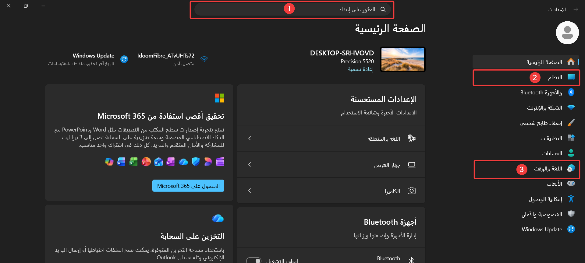
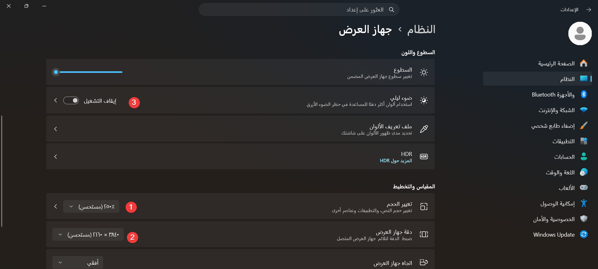
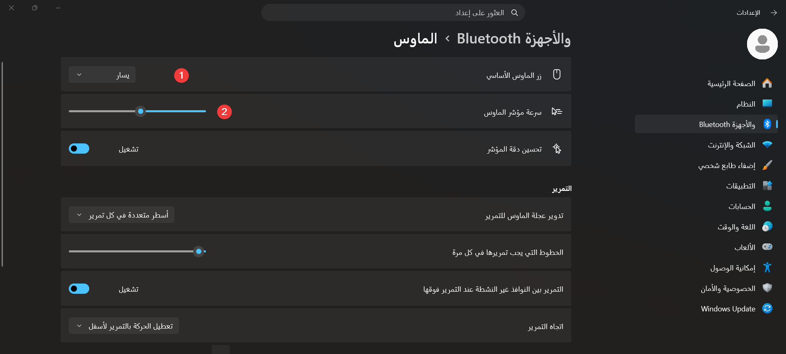
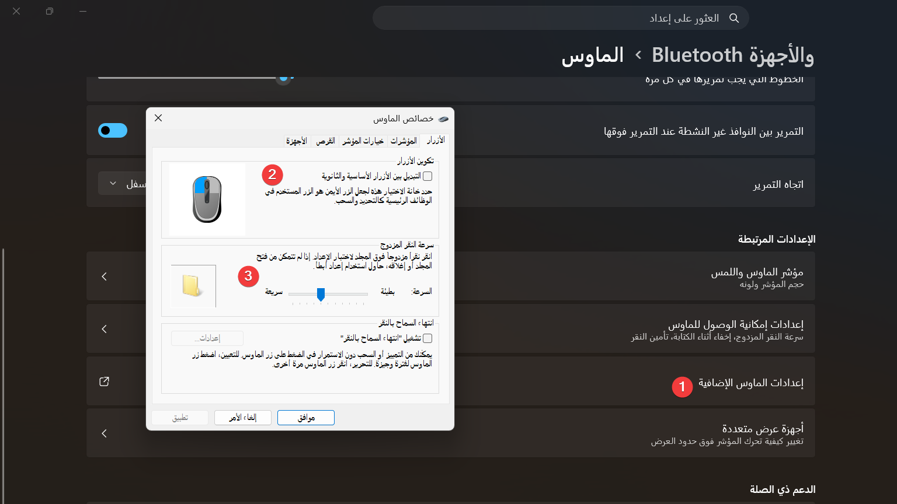
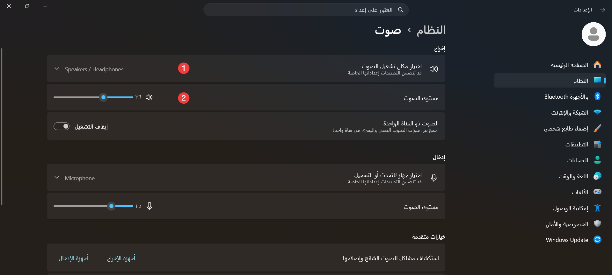

# الوحدة 04: إعدادات النظام — لوحة التحكم وتطبيق الإعدادات

## المجال المفاهيمي الأول: التعامل مع بيئة الحاسوب

**المستوى:** السنة الأولى ثانوي (1AS)  
**المدة الزمنية:** ساعة واحدة

---

## الأهداف التعلمية

في نهاية هذه الوحدة، يكون المتعلم قادرًا على أن:

1. يعرّف لوحة التحكم (Control Panel) ويحدد مكانها في Windows 8.1 وWindows 11.
2. يفتح تطبيق الإعدادات (Settings) بأكثر من طريقة ويصل إلى الإعداد المطلوب في ثلاث نقرات.
3. يفرّق بين **المقياس** (Scale) و**دقة العرض** (Resolution) ويضبطهما بما يناسب الشاشة والعين.
4. يعدّل إعدادات الفأرة (الزر الأساسي، سرعة المؤشر، سرعة النقر المزدوج) ويفسّر أثر كل إعداد.
5. يضبط التاريخ والوقت والمنطقة الزمنية (GMT+1) ويضيف لغة إدخال وينتقل بينها.
6. يثبّت برنامجًا من مصدر موثوق ويلغي تثبيت برنامج آخر بالطريقة الصحيحة.
7. يميّز بين حساب المسؤول (Administrator) والحساب القياسي (Standard) ويُنشئ حسابًا محليًا يحميه برمز PIN.
8. يشرح دور تحديثات النظام (Windows Update) ويقوم بالتحقق منها.
9. يتخذ قرارات مسؤولة تجاه خصوصيته وأمان جهازه المشترك.

---

## خريطة التعلم في حصة واحدة

| المرحلة | السؤال المركزي | ناتج التعلّم القابل للملاحظة |
|---|---|---|
| الانطلاق (5 د) | أين نذهب في الحاسوب عندما نريد تغيير شيء في النظام؟ | يذكر مسارين مختلفين للوصول إلى الإعدادات. |
| بناء التعلمات (35 د) | كيف نضبط الشاشة، الفأرة، الصوت، الوقت، اللغة، البرامج والحسابات؟ | ينفّذ سلسلة إعدادات على جهازه دون مساعدة. |
| التطبيق والتقويم (20 د) | كيف نهيّئ حاسوبًا مشتركًا بين عدة مستخدمين؟ | يُنتج حسابًا قياسيًا مضبوطًا ويشرح اختياراته. |

> هذه الوحدة هي **غرفة تحكم** الحاسوب: كل ما لا تجده على سطح المكتب من تغييرات (ألوان، لغة، برامج، حسابات) تجده هنا. وكل تغيير تُحدثه يُحفظ في الجهاز ويؤثر على كل من يستعمله، لذلك نغيّر بوعي لا بتجريب عشوائي.

---

## 1. من لوحة التحكم إلى تطبيق الإعدادات

### أ. ما هي لوحة التحكم؟

**لوحة التحكم** (Control Panel / *Panneau de configuration*) برنامج مدمج في نظام التشغيل بواجهة بيانية، تُعدّ مركز إعدادات الحاسوب: تسمح بعرض وضبط الإعدادات الأساسية مثل خصائص العرض، والفأرة، والتاريخ والوقت، واللغة، والبرامج المثبتة، وحسابات المستخدمين.

### ب. لماذا انتقلت مايكروسوفت إلى تطبيق الإعدادات؟

منذ Windows 8 ثم Windows 10، ثم بصورة كاملة في **Windows 11**، انتقلت معظم الإعدادات إلى تطبيق حديث اسمه **الإعدادات (Settings)**، بينما بقيت لوحة التحكم الكلاسيكية موجودة لكنها لم تعد المسار الرئيسي.

| وجه المقارنة | لوحة التحكم الكلاسيكية | تطبيق الإعدادات (Windows 11) |
|---|---|---|
| الشكل | نوافذ صغيرة متعددة (Dialogs) | نافذة واحدة بأقسام مرتبة |
| طريقة البحث | بحث داخل النافذة | مربع بحث موحّد في الأعلى |
| الاستعمال | إعدادات متقدمة وبعض الأدوات القديمة | معظم الإعدادات اليومية |
| الحالة اليوم | موجودة لكنها في طريق الإهمال | المسار الرسمي المعتمد |

> **معلومة:** لا تزال لوحة التحكم ضرورية لبعض المهام المتقدمة، مثل: إلغاء تثبيت البرامج في النسخ القديمة، وإدارة الأجهزة (Device Manager)، وإعدادات الشبكة المتقدمة، ونافذة خصائص الفأرة الكلاسيكية.

### ج. كيف نفتح تطبيق الإعدادات؟

| الطريقة | الخطوات |
|---|---|
| الاختصار السريع | `Win + I` |
| قائمة ابدأ | زر ابدأ ← الإعدادات (Settings) |
| قائمة النظام السريعة | `Win + X` ← الإعدادات |
| البحث | اكتب «الإعدادات» في مربع البحث ثم Enter |

> **مسار Windows 8.1 في المخبر:** لا يوجد تطبيق إعدادات كامل كما في Windows 11، بل شريط جانبي اسمه **إعدادات الكمبيوتر** (PC settings) يُفتح بـ `Win + C` ثم Settings، وبقيّة الإعدادات تُنجز من **لوحة التحكم** (`Win + X` ← Control Panel).

### د. جدول المسارات المزدوجة

هذا الجدول هو مرجعك خلال الحصة: العمود الثالث هو ما ستجده فعليًا على جهاز المخبر.

| الإعداد المطلوب | المسار في Windows 11 | المسار في Windows 8.1 (المخبر) |
|---|---|---|
| صفحة الإعدادات العامة | `Win + I` | `Win + C` ← Settings ← Change PC settings |
| العرض والدقة | النظام ← العرض | لوحة التحكم ← العرض |
| الفأرة | Bluetooth والأجهزة ← الفأرة | لوحة التحكم ← الفأرة |
| الصوت | النظام ← الصوت | لوحة التحكم ← الصوت |
| اللغة | الوقت واللغة ← اللغة والمنطقة | لوحة التحكم ← اللغة |
| التاريخ والوقت | الوقت واللغة ← التاريخ والوقت | لوحة التحكم ← التاريخ والوقت |
| إلغاء تثبيت برنامج | التطبيقات ← التطبيقات المثبتة | لوحة التحكم ← البرامج ← إلغاء تثبيت برنامج |
| الحسابات | الحسابات ← مستخدمون آخرون | إعدادات الكمبيوتر ← الحسابات |
| التحديثات | Windows Update | لوحة التحكم ← Windows Update |

---

## 2. تخصيص العرض (Display)

مسارنا: **الإعدادات ← النظام ← العرض**.

هنا إعدادان يخلط بينهما كثير من المستخدمين، والفرق بينهما جوهري:

| الإعداد | ماذا يفعل؟ | متى نغيّره؟ |
|---|---|---|
| **المقياس** (Scale — يظهر في الواجهة العربية باسم **«تغيير الحجم»**) | يكبّر العناصر (النصوص، الأيقونات، الأزرار) دون تغيير عدد النقاط | عندما تكون الكتابة صغيرة بالنسبة لحجم الشاشة |
| **دقة العرض** (Resolution) | يحدّد عدد النقاط (البكسل) المعروضة أفقيًا وعموديًا | عندما تظهر الصورة ضبابية أو غير ملائمة للشاشة |

> **قاعدة عملية:** الدقة الموصى بها (Recommended) هي الخيار الصحيح في أغلب الحالات؛ وابدأ منها ثم كبّر المقياس إن كانت الكتابة صغيرة. لا تُنقص الدقة لتكبير النص، لأن الصورة تصبح ضبابية.

ومن خصائص العرض المفيدة:

- **ضوء ليلي** (Night light): تخفّف الضوء الأزرق في المساء وتريح العين قبل النوم.
- **الوضع الداكن** (Dark mode): يقلّل الإضاءة المنبعثة في الغرف المعتمة، وهو فرع من التخصيص (Personalization).
- **اتجاه العرض** (Orientation): يهمّ الشاشات الدوّارة والأجهزة اللوحية.

> **مسار Windows 8.1 في المخبر:** تغيير الدقة موجود في **لوحة التحكم ← العرض ← تغيير دقة الشاشة**، أما **ضوء ليلي والوضع الداكن فغير موجودين** في 8.1؛ لا تبحث عنهما في المخبر.

---

## 3. إعدادات الفأرة (Mouse)

مسارنا: **الإعدادات ← Bluetooth والأجهزة ← الفأرة**.

أربعة إعدادات تكفي لتخصيص الفأرة:

1. **الزر الأساسي** (Primary mouse button — **«زر الماوس الأساسي»** في الواجهة): افتراضيًا الزر الأيسر. يستعمله الأشخاص الذين يكتبون باليد اليسرى فيحوّلونه إلى الأيمن.
2. **سرعة المؤشر** (Mouse pointer speed — **«سرعة مؤشر الماوس»**): كلما زادت تحرّك المؤشر مسافة أطول بنفس حركة اليد. الإفراط فيها يجعل الدقة أصعب، خصوصًا في الرسم.
3. **سرعة النقر المزدوج** (Double-click speed): المدة القصوى بين النقرتين ليُعتبر النقر نقرة مزدوجة. إن كانت قصيرة جدًا فستُفتح الملفات بنقرة واحدة بالخطأ.
4. **إعدادات الفأرة الإضافية** (Additional mouse settings): تفتح النافذة الكلاسيكية **خصائص الفأرة** (Mouse Properties) وفيها تبويبات إضافية: شكل المؤشر (Pointer)، وإخفاء المؤشر أثناء الكتابة، وإظهار مساره.

> **مسار Windows 8.1 في المخبر:** لا توجد صفحة الفأرة في إعدادات الكمبيوتر، بل تُفتح النافذة الكلاسيكية مباشرة من **لوحة التحكم ← الفأرة**. وهي **نفس النافذة** تقريبًا في Windows 7 و8.1 و10 و11، لذلك يمكنك استعمالها في المخبر بلا فرق يذكر.

### تطبيق سريع (3 دقائق)

جرّب على جهازك: هل مؤشر الفأرة يتحرك أسرع أم أبطأ من جهاز زميلك؟ لماذا؟ ثم أعِد الإعداد إلى القيمة الوسطى.

---

## 4. الصوت وأجهزة الإخراج (Sound)

مسارنا: **الإعدادات ← النظام ← الصوت**.

- **جهاز الإخراج** (Output): تختار سماعات أو مكبّر صوت أو شاشة. إن لم تسمع شيئًا فابدأ من هنا قبل أن تظن أن الجهاز معطّل.
- **مستوى الصوت** (Volume): يضبط شدة الصوت، ويمكن كتمه من أيقونة الصوت في شريط المهام.
- **إعدادات صوت إضافية**: تفتح نافذة **الصوت** الكلاسيكية (تبويبات Playback وRecording وSounds).

> **تذكير مواطن:** استعمل السماعات في المخبر ولا ترفع الصوت؛ مشاركة الآخرين في الفضاء نفسه جزء من احترام بيئة العمل.
>
> **مسار Windows 8.1 في المخبر:** **لوحة التحكم ← الصوت ← تبويب التشغيل (Playback)** لاختيار جهاز الإخراج.

---

## 5. الوقت واللغة والمنطقة (Time & Language)

### أ. التاريخ والوقت والمنطقة الزمنية

مسارنا: **الإعدادات ← الوقت واللغة ← التاريخ والوقت**.

- **الضبط التلقائي** (Set time automatically): يزامن الساعة مع خوادم الإنترنت، وهو الخيار الأنسب دائمًا.
- **المنطقة الزمنية** (Time zone): الجزائر تقع في **(UTC+01:00) الجزائر**، أي **GMT+1** كما ورد في الكتاب المدرسي.
- **المزامنة الآن** (Sync now): تُصلح فرقًا بسيطًا في الدقائق.
- عند تعطّل الإنترنت، تُضبط الساعة يدويًا، لكن التاريخ الخاطئ يُفسد شهادات المواقع ورسائل البريد.

### ب. اللغة ولوحة المفاتيح

مسارنا: **الإعدادات ← الوقت واللغة ← اللغة والمنطقة**.

- **لغة العرض** (Windows display language): لغة القوائم والرسائل، وتتطلب إعادة تشغيل أو تسجيل خروج.
- **اللغات المفضّلة** (Preferred languages): تضع فيها العربية والفرنسية والإنجليزية حسب حاجتك.
- **إضافة لغة**: تختار اللغة ثم لوحة مفاتيحها، مثل: **العربية (الجزائر)** أو **الفرنسية (فرنسا)**.
- **التبديل بين لوحات المفاتيح**: `Win + Space`، أو `Alt + Shift` في الإعدادات الأقدم. لاحظ ظهور رمز اللغة (AR/FR) قرب الساعة.

> **تحذير عملي:** تغيير **لغة العرض** في حاسوب المخبر يغيّر واجهة كل التلاميذ. غيّر **لغة الإدخال** فقط (وهي ما تحتاجه للكتابة بالعربية أو الفرنسية)، واترك لغة العرض كما هي.

> **مسار Windows 8.1 في المخبر:** **لوحة التحكم ← اللغة ← إضافة لغة** ثم نقلها إلى الأعلى، و**لوحة التحكم ← التاريخ والوقت ← تغيير المنطقة الزمنية**.

---

## 6. البرامج: التثبيت وإلغاء التثبيت

مسارنا: **الإعدادات ← التطبيقات ← التطبيقات المثبتة** (Installed apps).

- **التثبيت** (Installation): نسخ برنامج إلى الجهاز وإعداده للعمل، ويتم بملف تنفيذي (`.exe` أو `.msi`) أو من متجر موثوق مثل **Microsoft Store**.
- **إلغاء التثبيت** (Uninstallation): إزالة البرنامج إزاءً نهائيًا مع ملفاته وإعداداته وسجلاته من النظام.
- **لا تحذف مجلد البرنامج من `Program Files`**، لأن بقايا الإعدادات والسجلات تبقى وتُبطئ الجهاز وقد تُعطّله.

خطوات إلغاء التثبيت:

1. اكتب اسم البرنامج في مربع البحث لتقصير القائمة.
2. اضغط زر المزيد (**⋯**) أمام البرنامج.
3. اختر **إلغاء التثبيت** (Uninstall) واتبع التعليمات.
4. أعد تشغيل الجهاز إن طُلب منك ذلك.

> **قاعدة أمنية:** لا تثبّت برنامجًا من رابط مجهول أو من رسالة تطلب منك تسريع الجهاز أو تنظيفه؛ فمعظم البرمجيات الخبيثة تدخل من هنا. أثناء التثبيت، أَلْغِ تحديد أي برنامج إضافي يُقترح عليك.

> **مسار Windows 8.1 في المخبر:** **لوحة التحكم ← البرامج ← إلغاء تثبيت برنامج** (Programs and Features)، ثم انقر بالزرّ الأيمن على البرنامج واختر **إلغاء التثبيت**.

---

## 7. حسابات المستخدمين (User Accounts)

### أ. ما هو حساب المستخدم؟

حساب المستخدم هو مجموعة الصلاحيات التي تُمنح لشخص على حاسوب معيّن، مع مساحة عمل خاصة به: ملفاته ومجلداته وإعداداته وواجهته. الحاسوب الواحد يمكن أن يضمّ عدة حسابات، ولكل حساب ملفات لا يراها الآخرون افتراضيًا.

### ب. أنواع الحسابات

| النوع | الصلاحيات | لمن؟ |
|---|---|---|
| **حساب المسؤول** (Administrator) | تثبيت البرامج والأجهزة وإلغاؤها، تغيير كل إعدادات النظام، إنشاء حسابات الآخرين وحذفها وتغيير أنواعها | مالك الجهاز أو تقني المخبر |
| **الحساب القياسي** (Standard) | استعمال البرامج المثبتة والملفات الشخصية، وتغيير صورته وكلمة مروره، دون تعديل إعدادات النظام | التلاميذ، أفراد العائلة، مستخدمو الحاسوب المشترك |
| **حساب الطفل** (Child account) | حساب قياسي مرتبط بحساب مايكروسوفت للعائلة، مع حدود وقت الشاشة والمواقع | الأطفال في المنزل |

> **تغيّر مهم عن الكتاب المدرسي القديم:** كان Windows 7 و8.1 يعرضان **حساب الضيف** (Guest / *Invité*)، وهو حساب بلا كلمة مرور. **أزالته مايكروسوفت** لأنه ثغرة أمنية: أي شخص يفتح الجهاز يجد كل شيء. بديله اليوم: **حساب قياسي بكلمة مرور أو رمز PIN**، أو تفعيل وضع **الحاسوب المشترك** (Shared PC).

### ج. حساب مايكروسوفت أم حساب محلي؟

| | حساب مايكروسوفت (Microsoft account) | حساب محلي (Local account) |
|---|---|---|
| ما هو؟ | بريد إلكتروني مرتبط بخدمات مايكروسوفت | حساب موجود على الجهاز وحده |
| الفائدة | مزامنة الإعدادات والملفات، OneDrive، استرجاع كلمة المرور | استقلال عن الإنترنت، خصوصية أكبر |
| في المخبر | غير مناسب للحسابات المشتركة | **الأنسب** لحسابات التلاميذ |

خطوات إنشاء حساب محلي: **الحسابات ← مستخدمون آخرون ← إضافة حساب ← ليس لدي معلومات تسجيل الدخول ← إضافة حساب محلي**، ثم تكتب اسم المستخدم وكلمة المرور وسؤال الأمان.

### د. حماية الحساب: PIN وWindows Hello

- **رمز PIN**: أربعة أرقام أو أكثر، أسرع من كلمة المرور، ويرتبط بالجهاز نفسه فلا يُستعمل على جهاز آخر.
- **Windows Hello**: التعرّف على الوجه أو بصمة الإصبع في الأجهزة المجهّزة، وهو أسرع وأكثر أمانًا من كلمة المرور.
- **التحكم في حساب المستخدم** (UAC): نافذة تظهر عند محاولة تغيير إعداد حساس أو تثبيت برنامج، وتطلب موافقة المسؤول. ظهورها ليس خطأً بل حماية.
- **قفل الشاشة**: `Win + L` قبل مغادرة الجهاز، وهي عادة يجب أن تصبح تلقائية.

> **مسار Windows 8.1 في المخبر:** **إعدادات الكمبيوتر ← الحسابات ← حسابات أخرى**. وانتبه: 8.1 لا يزال يسمح بتفعيل **حساب الضيف** في لوحة التحكم؛ لا تستعمله ولا تُعِد تفعيله.

---

## 8. تحديث النظام (Windows Update)

مسارنا: **الإعدادات ← Windows Update**.

- التحديثات تُصلح ثغرات أمنية وتُحسّن الأداء وتضيف خصائص.
- **التحقق من التحديثات** (Check for updates) يُنجز يدويًا، ويُنجز تلقائيًا في الخلفية.
- **إيقاف التحديثات مؤقتًا** (Pause updates) مفيد قبل حصّة أو عرض تقديمي، وليس حلاً دائمًا.
- لا تُطفئ الجهاز أثناء التحديث؛ قد يتلف النظام.

> **مسار Windows 8.1 في المخبر:** **لوحة التحكم ← Windows Update ← البحث عن تحديثات**.

---

## 9. الخصوصية والأمان (تمهيد)

مسارنا: **الإعدادات ← الخصوصية والأمان**.

هنا تتحكم في من يستطيع الوصول إلى موقعك وكاميرتك وميكروفونك، وفي البيانات التشخيصية التي تُرسل إلى مايكروسوفت. وفي القسم نفسه تجد **أمان Windows** (جدار الحماية ومكافح الفيروسات).

> التفصيل الكامل في **الوحدة 05: حماية الحاسوب**، ويكفي هنا أن يعرف التلميذ أن الإذن قابل للسحب في أي وقت.

---

## نشاط تطبيقي: تهيئة حاسوب مشترك

**الوضعية:** اشترت عائلتك حاسوبًا واحدًا. أخوك الصغير يريد أن يلعب ويبحث، وأنت تحتاج ملفاتك وبرامجك، وأبوك هو من يثبّت البرامج. المطلوب تهيئة الجهاز ليستعمله الجميع دون أن يُفسد أحد عمل الآخر.

**العمل:** فرديًا أو في ثنائيات — **المدة:** 15 دقيقة.

| المهمة | ما يجب إنجازه | مؤشر النجاح |
|---|---|---|
| 1 | تحديد نوع الحساب المناسب لكل فرد | جدول مكتمل مع تبرير لكل اختيار |
| 2 | إنشاء حساب قياسي تجريبي وحمايته برمز PIN | الحساب يظهر في «مستخدمون آخرون» برمز PIN |
| 3 | ضبط المقياس على القيمة الموصى بها وتشغيل ضوء ليلي | شرح الفرق بين المقياس والدقة شفويًا |
| 4 | إضافة لغة الإدخال العربية والفرنسية والتبديل بينهما | الكتابة تنتقل من AR إلى FR بـ `Win + Space` |
| 5 | ضبط المنطقة الزمنية GMT+1 وتفعيل المزامنة | تظهر (UTC+01:00) الجزائر |
| 6 | إلغاء تثبيت برنامج غير مرغوب فيه | البرنامج اختفى من قائمة التطبيقات |

**تسليم:** جدول أنواع الحسابات + لقطة شاشة واحدة لكل إنجاز (أو شرح شفوي عند تعذّر التصوير).

---

## تقويم ختامي للوحدة

1. **المفاهيم:** ما الفرق بين **لوحة التحكم** و**تطبيق الإعدادات**؟ ولماذا بقيت الأولى موجودة؟
2. **العرض:** تلميذ اشتكى من صغر الكتابة على شاشته، فأنقص دقة العرض. هل اختياره صحيح؟ ما البديل؟
3. **الفأرة:** ما أثر رفع **سرعة النقر المزدوج** إلى أقصى قيمة؟ ومتى يغيّر المستخدم **الزر الأساسي**؟
4. **الوقت واللغة:** الجهاز يعرض الساعة متأخرة 40 دقيقة. اذكر خطوتين لإصلاح ذلك، وبيّن أهمية المنطقة الزمنية GMT+1.
5. **البرامج:** لماذا لا يكفي حذف مجلد البرنامج من `Program Files` لإلغاء تثبيته؟
6. **الحسابات:** حاسوب مخبر يستعمله 20 تلميذًا يوميًا. أي نوع حساب تختار لكل تلميذ ولماذا؟ وما خطر حساب الضيف؟

---

## بطاقة خروج سريعة (3–2–1)

قبل مغادرة الحصة، اكتب في دقيقة واحدة:

- **3** إعدادات تعلمت ضبطها في هذه الحصة.
- **2** اختلافين بين Windows 11 وWindows 8.1 في الوصول إلى الإعدادات.
- **1** سؤال ما زال لديك حول إعدادات النظام.

يستعملها الأستاذ لبداية الحصة التالية: يُجيب عن السؤال المتكرر ويصحّح المفهوم الخاطئ الشائع.

---

### بطاقة إجابة مختصرة للأستاذ

1. **لوحة التحكم وتطبيق الإعدادات:** لوحة التحكم برنامج كلاسيكي بنوافذ متعددة؛ تطبيق الإعدادات واجهة حديثة موحّدة تحمل معظم الإعدادات في Windows 11. بقيت لوحة التحكم للأدوات المتقدمة (إدارة الأجهزة، خصائص الفأرة الكلاسيكية، الشبكة المتقدمة، برامج النسخ القديمة).
2. **المقياس والدقة:** الإجابة الصحيحة: الإجراء خاطئ. إنقاص الدقة يُضبّب الصورة؛ البديل هو رفع **المقياس** (125% أو 150%) مع الإبقاء على الدقة الموصى بها.
3. **الفأرة:** رفع سرعة النقر المزدوج إلى أقصى قيمة يجعل النقرتين المتقاربتين تُفهمان كنقرتين منفصلتين، فتصعب فتح الملفات. ويغيّر المستخدم الزر الأساسي عند استعمال اليد اليسرى (أو لتسهيل النقر لشخص معيّن).
4. **الوقت:** تفعيل **الضبط التلقائي** ثم **المزامنة الآن**، أو ضبط الوقت يدويًا مع تصحيح المنطقة الزمنية إلى **(UTC+01:00) الجزائر**. المنطقة الزمنية تضمن توقيت الرسائل والمواعيد والملفات المشتركة.
5. **حذف المجلد:** لا يزيل سجلات النظام (Registry) ولا ملفات الإعدادات ولا خدمات البرنامج، فتبقى بقايا تُبطئ الجهاز؛ والإزالة الصحيحة عبر «التطبيقات المثبتة» أو «البرامج والميزات».
6. **الحسابات:** حساب **قياسي** لكل تلميذ (أو حساب مشترك قياسي في المخبر) لأن التلميذ لا يحتاج تثبيت برامج أو تغيير إعدادات النظام، ولأن حساب المسؤول يفتح الباب للتخريب. أما **حساب الضيف** فقد أُزيل من Windows 11 لأنه بلا كلمة مرور ويمنح أي عابر وصولًا كاملًا.

---

## معجم المصطلحات

| المصطلح | العربية | الشرح المختصر |
|---|---|---|
| Control Panel | لوحة التحكم | مركز الإعدادات الكلاسيكي في نظام التشغيل |
| Settings | الإعدادات | التطبيق الحديث لإعدادات النظام |
| Scale | المقياس | تكبير عناصر الواجهة دون تغيير الدقة |
| Resolution | دقة العرض | عدد نقاط الصورة المعروضة |
| Night light | ضوء ليلي | تقليل الضوء الأزرق في المساء |
| Uninstall | إلغاء التثبيت | إزالة البرنامج وملفاته من النظام |
| Administrator | حساب المسؤول | حساب بصلاحيات كاملة على النظام |
| Standard user | حساب قياسي | حساب محدود الصلاحيات للاستعمال اليومي |
| UAC | التحكم في حساب المستخدم | نافذة الموافقة عند تغيير إعداد حساس |
| Windows Hello | — | الدخول بالوجه أو البصمة أو رمز PIN |
| Windows Update | تحديث Windows | خدمة تنزيل تحديثات النظام وأمانه |
