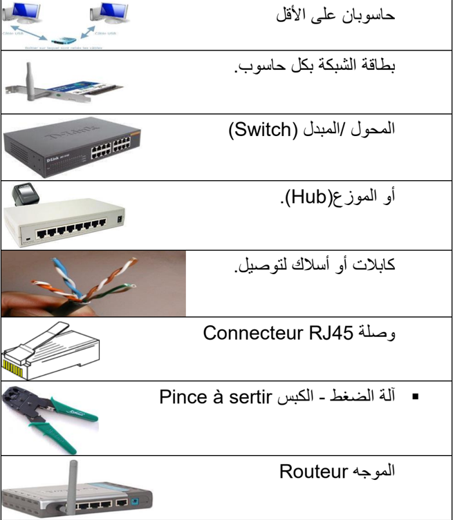
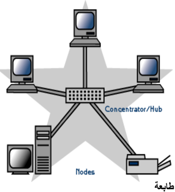
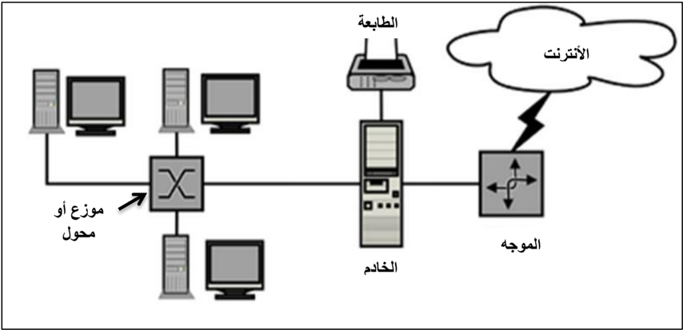

# الوحدة 06: الشبكة المحلية — ربط الحواسيب ومشاركة الموارد

## المجال المفاهيمي الأول: التعامل مع بيئة الحاسوب

**المستوى:** السنة الأولى ثانوي (1AS)  
**المدة الزمنية:** 04 ساعات (أسبوعان: حصص نظرية + حصص تطبيقية في المخبر)

---

## الأهداف التعلمية

في نهاية هذه الوحدة، يكون المتعلم قادرًا على أن:

1. يعرّف الشبكة (Network / *Réseau*) ويذكر فوائدها في المدرسة والمنزل.
2. يصنّف الشبكات حسب **وسيلة الربط** (سلكية / لاسلكية)، و**الامتداد الجغرافي** (PAN، LAN، MAN، WAN)، و**العلاقة الوظيفية** (خادم/زبون، ند للند).
3. يميّز بين الشبكة السلكية والشبكة اللاسلكية من حيث السرعة والاستقرار والتنقل والأمان.
4. يتعرّف على المكونات المادية للشبكة المحلية: بطاقة الشبكة، الكابل والوصلة RJ45، المحوّل، الموجّه، نقطة الوصول.
5. يشرح الفرق بين **الموزّع** (Hub) و**المحوّل** (Switch) و**الموجّه** (Router).
6. يرسم شبكة محلية بطوبولوجيا النجمة، ويقارنها باختصار بطوبولوجيا الباص والحلقة.
7. يحدّد اسم حاسوبه ومجموعة العمل التي ينتمي إليها وعنوانه IP.
8. يشارك مجلدًا (وعند الحاجة قرصًا) بإذن القراءة أو القراءة/الكتابة، ويصل إلى مورد مشترك على حاسوب آخر.
9. يكتشف حاسوبًا أو مجلدًا مشتركًا داخل مجموعة العمل، ويطبّق قواعد المشاركة الآمنة.

---

## خريطة التعلم في أربع حصص

| الحصة | السؤال المركزي | ناتج التعلّم القابل للملاحظة |
|---|---|---|
| الحصة 1 (نظري) | لماذا نربط الحواسيب؟ وما أنواع الشبكات؟ | يصنّف شبكات من محيطه (المنزل، الثانوية، المدينة، الإنترنت) ويبرّر تصنيفه. |
| الحصة 2 (نظري) | ما العتاد الذي يبني الشبكة؟ وكيف نرتّبه؟ | يرسم شبكة نجمية ويسمّي كل جهاز فيها، ويفرّق بين Hub وSwitch وRouter. |
| الحصة 3 (تطبيقي) | كيف يتعرّف الحاسوب على الشبكة ويُعرَف فيها؟ | يجد اسم حاسوبه ومجموعة العمل وعنوانه IP، ويتحقق من نوع ملف تعريف الشبكة. |
| الحصة 4 (تطبيقي) | كيف نشارك مجلدًا أو قرصًا ونصل إليه بأمان؟ | يصل إلى مجلد مشترك من جهازه، ويختبر الفرق بين القراءة والكتابة. |

> **فكرة الوحدة:** في منزلك شبكة صغيرة لا تراها: الهاتف والحاسوب والتلفاز الذكي كلها مربوطة بالعلبة (Box) التي ركّبها مزوّد الإنترنت. في هذه الوحدة نفهم هذه «الشبكة الخفية»، ثم نبني في المخبر شبكة نتقاسم فيها الملفات والطابعة بدل أن ننقلها بمفتاح USB.

---

## 1. ما هي الشبكة؟

### أ. التعريف

**الشبكة** (Network / *Réseau*) مجموعة من جهازين أو أكثر (حواسيب، هواتف، طابعات...) متصلة ببعضها **سلكيًا أو لاسلكيًا**، بغرض **التواصل** و**تبادل البيانات** و**مشاركة الموارد**.

كل جهاز متصل بالشبكة يسمّى **عقدة** (Node / *Nœud*) أو **مضيفًا** (Host).

### ب. لماذا نربط الحواسيب؟

| الفائدة | مثال من الواقع |
|---|---|
| **مشاركة الموارد المادية** | طابعة واحدة في مكتب الإدارة يطبع منها كل الموظفين |
| **مشاركة الموارد البرمجية والبيانات** | مجلد «الدروس» على حاسوب الأستاذ يفتحه كل التلاميذ |
| **التواصل** | الرسائل الفورية، البريد الإلكتروني، مكالمات الفيديو |
| **مشاركة الاتصال بالإنترنت** | اشتراك واحد في المنزل يخدم الهاتف والحاسوب واللوحة |
| **العمل الجماعي واللعب** | حفلة ألعاب جماعية (LAN party) يلعب فيها الأصدقاء في الغرفة نفسها |
| **الإدارة المركزية والأمان** | النسخ الاحتياطي وتحديث كل أجهزة المخبر من مكان واحد |

> **تذكير:** الشبكة تنقل الفائدة وتنقل الخطر أيضًا. الدودة (Worm) التي درستها في **الوحدة 05** تنتشر عبر الشبكة، لذلك سنتعلم المشاركة **بقواعد**.

---

## 2. أصناف الشبكات

تُصنَّف الشبكات حسب ثلاثة معايير مختلفة، والشبكة الواحدة توصف بالمعايير الثلاثة معًا.

### أ. حسب وسيلة الربط: سلكية أم لاسلكية؟

- **الشبكة السلكية** (Wired / *Filaire*): تنقل البيانات عبر كابل، غالبًا كابل **إيثرنت** (Ethernet) بوصلة RJ45، أو عبر **الألياف البصرية** (Fiber optic / *Fibre optique*).
- **الشبكة اللاسلكية** (Wireless / *Sans fil*): تنقل البيانات بموجات الراديو، وأشهرها **Wi-Fi**، ومنها أيضًا **البلوتوث** (Bluetooth) للمسافات القصيرة جدًا.

| وجه المقارنة | الشبكة السلكية (إيثرنت) | الشبكة اللاسلكية (Wi-Fi) |
|---|---|---|
| **السرعة** | عالية وثابتة | جيدة لكنها تنخفض مع البعد والجدران وكثرة الأجهزة |
| **الاستقرار** | مستقر جدًا، تأثّره بالتشويش ضعيف | يتأثر بالجدران والأجهزة المجاورة والتشويش |
| **التنقل** | الجهاز مقيّد بطول الكابل | حرية التنقل داخل مجال التغطية |
| **التركيب** | يحتاج تمديد كوابل | سريع، دون أشغال |
| **الأمان** | يجب الوصول فيزيائيًا إلى الكابل | الموجات تتجاوز الجدران، فيلزم كلمة مرور قوية وتشفير (WPA2 / WPA3) |
| **الاستعمال المناسب** | حواسيب المخبر، الخوادم، الألعاب | الهواتف، الحواسيب المحمولة، المنزل |

> **قاعدة عملية:** ما لا يتحرّك (حاسوب مكتبي، طابعة، خادم) نربطه بكابل؛ وما يتحرّك (هاتف، حاسوب محمول) نربطه لاسلكيًا.

### ب. حسب الامتداد الجغرافي

| الصنف | الاسم الكامل | الامتداد | أمثلة |
|---|---|---|---|
| **PAN** | الشبكة الشخصية (Personal Area Network) | بضعة أمتار حول شخص واحد | هاتف مع سماعة أو ساعة ذكية عبر البلوتوث |
| **LAN** | الشبكة المحلية (Local Area Network) | غرفة، منزل، مبنى أو مؤسسة واحدة | شبكة المنزل، مخبر الإعلام الآلي، شبكة الثانوية |
| **MAN** | الشبكة الحضرية / الإقليمية (Metropolitan Area Network) | مدينة أو مجموعة مبانٍ متباعدة فيها | شبكة تربط مقرات بلدية أو كليات جامعة في مدينة واحدة |
| **WAN** | الشبكة الواسعة (Wide Area Network) | بلد، قارة، العالم كله | شبكة بنك بين ولايات الوطن، و**الإنترنت** وهي أكبر شبكة واسعة |

> **تصحيح مفهوم:** الثانوية الواحدة شبكة **محلية** (LAN) ولو كانت فيها عدة مخابر ومكاتب، لأنها تقع في موقع واحد تديره جهة واحدة. أما ربط عدة ثانويات في مدينة واحدة فيقترب من الشبكة **الحضرية** (MAN).

### ج. حسب العلاقة الوظيفية

| وجه المقارنة | خادم / زبون (Client-Server / *Client-Serveur*) | ند للند (Peer-to-Peer / *Poste à poste*) |
|---|---|---|
| **المبدأ** | حاسوب قوي (**الخادم** Server) يقدّم الخدمات، والحواسيب الأخرى (**الزبائن** Clients) تطلبها | كل الحواسيب متساوية؛ كل حاسوب يمكن أن يكون خادمًا وزبونًا في الوقت نفسه |
| **الإدارة** | مركزية: الحسابات والملفات تُدار من الخادم | موزّعة: كل مستخدم يدير مشاركة جهازه |
| **التكلفة** | مرتفعة (خادم + مسؤول شبكة) | منخفضة |
| **الحجم المناسب** | مؤسسات كبيرة، شبكات كثيرة الأجهزة | منزل، مكتب صغير، مخبر صغير |
| **في Windows** | **مجال** (Domain / *Domaine*) | **مجموعة عمل** (Workgroup / *Groupe de travail*) |
| **أمثلة** | خادم البريد الإلكتروني، موقع ويب، منصة رقمية | مخبر الإعلام الآلي، حواسيب المنزل، تطبيق مشاركة ملفات بين هاتفين |

> **مثال يومي:** عندما تفتح موقعًا على الإنترنت، فحاسوبك **زبون** يطلب صفحة من **خادم** بعيد. وعندما تفتح مجلدًا على حاسوب زميلك في المخبر، فأنتما في علاقة **ند للند**.

---

## 3. المكونات المادية للشبكة المحلية

> **ملاحظة على الصورة:** الموزّع (Hub) المذكور فيها جهاز قديم لم يعد يُشترى اليوم، وبطاقات الشبكة أصبحت في الغالب **مدمجة** في اللوحة الأم.

### أ. بطاقة الشبكة (Network Interface Card — NIC / *Carte réseau*)

القطعة التي تسمح للحاسوب بالاتصال بالشبكة، ولكل بطاقة **عنوان فيزيائي** فريد (MAC). نوعان:

- **بطاقة سلكية (إيثرنت):** منفذ RJ45 خلف الحاسوب، مدمجة في اللوحة الأم في أغلب الحواسيب.
- **بطاقة لاسلكية (محوّل Wi-Fi / Wi-Fi adapter):** مدمجة في الحواسيب المحمولة والهواتف، أو على شكل مفتاح USB صغير للحاسوب المكتبي.

### ب. الكابلات والوصلات

| العنصر | الوصف |
|---|---|
| **كابل الأزواج المجدولة** (Twisted pair / *Paire torsadée*) | ثمانية أسلاك ملتوية مثنى مثنى لتقليل التشويش؛ هو كابل الإيثرنت الشائع. فئاته الحالية **Cat 5e** و**Cat 6**، ولا يتجاوز طول الكابل الواحد نحو **100 متر**. |
| **الوصلة RJ45** (*Connecteur RJ45*) | رأس بلاستيكي شفاف بثمانية ملامس يُركَّب في طرفَي الكابل. |
| **آلة الكبس** (Crimping tool / *Pince à sertir*) | تثبّت الوصلة RJ45 على الكابل عند تحضيره يدويًا. |
| **الألياف البصرية** (Fiber optic) | تنقل البيانات بالضوء، سريعة جدًا وتقطع مسافات طويلة؛ تستعمل بين المباني ولربط المنازل بالإنترنت (FTTH). |

### ج. أجهزة الربط: الموزّع، المحوّل، الموجّه

- **الموزّع** (Hub / *Concentrateur*): جهاز مركزي قديم «غبي»: كل ما يصله من جهاز يعيد إرساله إلى **كل** الأجهزة المتصلة، فتزدحم الشبكة ويستطيع الجميع «سماع» ما لا يعنيهم.
- **المحوّل** (Switch / *Commutateur*): جهاز مركزي «ذكي»: يحفظ عنوان MAC لكل جهاز متصل بمنافذه، فيرسل البيانات إلى **الجهاز المقصود فقط**. هو قلب الشبكة المحلية اليوم.
- **الموجّه** (Router / *Routeur*): يربط **شبكتين مختلفتين أو أكثر**، أشهر مثال: ربط شبكة المنزل أو المخبر **بالإنترنت**. يختار الطريق المناسب للبيانات، وغالبًا يوزّع عناوين IP على الأجهزة تلقائيًا.

| وجه المقارنة | الموزّع (Hub) | المحوّل (Switch) | الموجّه (Router) |
|---|---|---|---|
| **الدور** | يربط أجهزة شبكة واحدة | يربط أجهزة شبكة واحدة | يربط شبكات مختلفة (LAN ↔ الإنترنت) |
| **لمن يرسل البيانات؟** | لكل الأجهزة | للجهاز المقصود فقط | للشبكة المقصودة عبر أفضل طريق |
| **يعتمد على** | لا شيء (يكرّر الإشارة) | عنوان MAC | عنوان IP |
| **الأداء والأمان** | ضعيف: ازدحام وتنصّت سهل | جيد | جيد، وغالبًا مزوّد بجدار ناري |
| **اليوم** | متجاوَز، لا يُستعمل تقريبًا | في كل مخبر ومؤسسة | في كل منزل ومؤسسة متصلة بالإنترنت |

> **تشبيه للتذكّر:** الموزّع يصرخ بالرسالة في القاعة كلها؛ المحوّل يسلّمها يدًا بيد لصاحبها؛ الموجّه ساعي بريد يحملها إلى مدينة أخرى.

### د. نقطة الوصول اللاسلكية والعلبة المنزلية

- **نقطة الوصول** (Access Point — AP / *Point d'accès*): تربط الأجهزة اللاسلكية بالشبكة السلكية؛ هي «المحوّل اللاسلكي» للشبكة.
- **العلبة المنزلية** (Box أو «المودم-الموجّه»): الجهاز الذي يركّبه مزوّد الإنترنت (مثل اتصالات الجزائر، عبر خط ADSL/VDSL أو الألياف البصرية). هي في الحقيقة **عدة أجهزة في علبة واحدة**:

| داخل العلبة المنزلية | دوره |
|---|---|
| **المودم** (Modem) | يحوّل إشارة خط الهاتف أو الألياف إلى بيانات يفهمها الحاسوب |
| **الموجّه** (Router) | يربط شبكة المنزل بالإنترنت ويوزّع عناوين IP |
| **المحوّل** (Switch) | منافذ RJ45 الخلفية لربط أجهزة بكابل |
| **نقطة الوصول** (Wi-Fi) | الشبكة اللاسلكية للهواتف والمحمولات |

---

## 4. طوبولوجيا الربط (Topology / *Topologie*)

**طوبولوجيا الربط** هي الشكل الذي تُوصَل به أجهزة الشبكة ببعضها.

### أ. طوبولوجيا النجمة (Star / *Étoile*) — الأكثر استعمالًا

كل جهاز (حاسوب، طابعة، نقطة وصول...) يتصل **بكابل مستقل** بجهاز مركزي واحد، هو اليوم **المحوّل** (Switch). البيانات تمرّ دائمًا عبر المركز.

> في الصورة كُتب على الجهاز المركزي «Hub»، وهذا ما كان شائعًا قديمًا؛ في شبكة اليوم نضع مكانه **محوّلًا** (Switch)، والشكل النجمي نفسه لا يتغيّر.

| المزايا | العيوب |
|---|---|
| تعطّل جهاز أو كابل واحد لا يوقف بقية الشبكة | تعطّل الجهاز المركزي يوقف الشبكة كلها |
| إضافة جهاز جديد سهلة: كابل جديد ومنفذ فارغ | تحتاج كوابل أكثر من الأشكال الأخرى |
| تحديد العطل سهل (أضواء المنافذ في المحوّل) | عدد الأجهزة محدود بعدد منافذ المحوّل (ويمكن ربط محوّلين) |

### ب. طوبولوجيا الباص (Bus) وطوبولوجيا الحلقة (Ring / *Anneau*) — لمحة

- **الباص (التشكيل الخطي):** كل الأجهزة متصلة بكابل رئيسي واحد. رخيصة، لكن انقطاع الكابل الرئيسي يوقف الجميع، والأجهزة تتزاحم عليه.
- **الحلقة:** كل جهاز متصل بجاره، والأخير متصل بالأول، والبيانات تدور في اتجاه واحد. انقطاع وصلة واحدة قد يوقف الحلقة.

**لماذا انتصرت النجمة؟** لأنها الأسهل في التركيب والتوسيع والصيانة، ولأن المحوّلات أصبحت رخيصة وسريعة. الباص والحلقة يُدرسان اليوم أساسًا لفهم تاريخ الشبكات.

### ج. نموذج: شبكة محلية متصلة بالإنترنت

اقرأ المخطط: الحواسيب ← **المحوّل** (شبكة نجمية محلية) ← **الخادم** الذي يشارك الطابعة ← **الموجّه** ← **الإنترنت** (الشبكة الواسعة).

---

## 5. كيف يُعرَف الحاسوب داخل الشبكة؟

### أ. اسم الحاسوب ومجموعة العمل

- **اسم الحاسوب** (Computer name): الاسم الذي يظهر للآخرين في الشبكة، مثل `LABO-PC05`. يجب أن يكون **فريدًا** في الشبكة.
- **مجموعة العمل** (Workgroup): اسم مشترك يجمع حواسيب شبكة ند للند. الاسم الافتراضي في Windows هو **`WORKGROUP`**، ويُستحسن أن تحمل كل حواسيب المخبر الاسم نفسه.

**أين نجدهما في Windows 11؟** الإعدادات ← النظام ← **حول** (About): يظهر اسم الجهاز، ومنه رابط **«المجال أو مجموعة العمل»** الذي يفتح النافذة الكلاسيكية **خصائص النظام** (تبويب اسم الكمبيوتر) لعرض مجموعة العمل وتغييرها.

> تغيير اسم الحاسوب أو مجموعة العمل يحتاج **حساب مسؤول** وإعادة تشغيل؛ في المخبر يقوم به الأستاذ أو التقني فقط.

### ب. عنوان IP وعنوان MAC

| العنوان | ما هو؟ | مثال | تشبيه |
|---|---|---|---|
| **عنوان IP** (Internet Protocol) | عنوان منطقي يحدّد مكان الجهاز في الشبكة، قد يتغيّر إن انتقل الجهاز إلى شبكة أخرى | `192.168.1.10` (عنوان IPv4 من أربعة أعداد بين 0 و255) | عنوان المنزل: الولاية، الشارع، الرقم |
| **عنوان MAC** (Media Access Control) | عنوان فيزيائي ثابت محفور في بطاقة الشبكة | `3C-52-82-1A-4F-07` | رقم بطاقة التعريف الوطنية |

> **معلومة:** الأجهزة في الشبكة المحلية نفسها تتشابه بداية عناوينها (مثل `192.168.1.x`)، كما يتشارك سكّان الشارع الواحد اسم الشارع ويختلفون في رقم المنزل.

### ج. كيف أعرف عنواني؟

| الطريقة | الخطوات |
|---|---|
| **موجّه الأوامر** | `Win + R` ← اكتب `cmd` ← Enter ← اكتب `ipconfig` ← ابحث عن سطر **IPv4 Address**. ولعرض عنوان MAC أيضًا: `ipconfig /all` (سطر **Physical Address**). |
| **الإعدادات (Windows 11)** | الإعدادات ← الشبكة والإنترنت ← Ethernet أو Wi-Fi ← الخصائص: يظهر عنوان IPv4 والعنوان الفعلي (MAC). |

> **مسار Windows 8.1 في المخبر:** الأمر `ipconfig` يعمل بالطريقة نفسها تمامًا في كل إصدارات Windows؛ استعمله أولًا.

---

## 6. إعداد الشبكة في Windows 11

بعد الربط المادي، يجب أن «يقبل» كل حاسوب أن يُرى ويشارك. يتم ذلك في ثلاث خطوات:

### أ. نوع ملف تعريف الشبكة: خاصة أم عامة؟

**المسار:** الإعدادات ← الشبكة والإنترنت ← Wi-Fi (ثم خصائص الشبكة المتصلة) أو Ethernet ← **نوع ملف تعريف الشبكة**.

| النوع | المعنى | متى نختاره؟ |
|---|---|---|
| **شبكة عامة** (Public) | الجهاز مخفي عن الآخرين، والمشاركة متوقفة | مقهى، فندق، محطة، أي Wi-Fi لا تعرف من يتصل به (**الخيار الآمن الافتراضي**) |
| **شبكة خاصة** (Private) | يمكن اكتشاف الجهاز ومشاركة الملفات والطابعات | المنزل، المخبر، المكتب: شبكة تثق بكل أجهزتها |

### ب. إعدادات المشاركة المتقدمة

**المسار:** الإعدادات ← الشبكة والإنترنت ← **إعدادات الشبكة المتقدمة** ← **إعدادات المشاركة المتقدمة**.

نفعّل في قسم **الشبكات الخاصة** فقط:

- **اكتشاف الشبكة** (Network discovery): يسمح لحاسوبك برؤية الأجهزة الأخرى، ولها برؤيته.
- **مشاركة الملفات والطابعات** (File and printer sharing): يسمح للآخرين بالوصول إلى ما تشاركه.

وفي قسم **جميع الشبكات** يوجد خيار **المشاركة المحمية بكلمة مرور** (Password protected sharing)، وهو **مفعّل افتراضيًا**: من يريد فتح مجلدك عليه أن يدخل اسم مستخدم وكلمة مرور حساب موجود **على حاسوبك**. هذا ما يمنع أي غريب في الشبكة من الدخول.

> **مسار Windows 8.1 في المخبر:** لوحة التحكم ← الشبكة والإنترنت ← **مركز الشبكة والمشاركة** ← **تغيير إعدادات المشاركة المتقدمة**. الخيارات نفسها تقريبًا: اكتشاف الشبكة، مشاركة الملفات والطابعات، المشاركة المحمية بكلمة مرور.

### ج. التحقق من مجموعة العمل

تأكّد (كما في القسم 5) أن كل الحواسيب تحمل **أسماء مختلفة** و**مجموعة العمل نفسها**. في Windows الحديث يكفي غالبًا أن تكون الحواسيب في الشبكة نفسها لتتواصل، لكن توحيد مجموعة العمل يجعل ترتيبها في نافذة «الشبكة» أوضح.

---

## 7. مشاركة الموارد

### أ. ماذا نشارك؟

| نوع المورد | أمثلة |
|---|---|
| **موارد مادية** | الطابعة، الماسح الضوئي، القرص الصلب أو أحد أجزائه، الاتصال بالإنترنت |
| **موارد برمجية وبيانات** | المجلدات والملفات، الوثائق المشتركة، قاعدة بيانات، برنامج مثبت على الخادم |

### ب. مستويات الإذن (Permissions)

| الإذن | ماذا يستطيع الآخرون؟ | متى نستعمله؟ |
|---|---|---|
| **قراءة** (Read / *Lecture*) | فتح الملفات ونسخها فقط، دون تعديل أو حذف | توزيع درس أو تمرين على التلاميذ |
| **قراءة/كتابة** (Read/Write) — في المشاركة المتقدمة: **تغيير** (Change) | إضافة الملفات وتعديلها وحذفها | مجلد «تسليم الأعمال» أو مشروع جماعي |
| **تحكم كامل** (Full Control) | كل ما سبق + تغيير الأذونات نفسها | نادرًا، لصاحب الجهاز أو المسؤول فقط |

> **مبدأ أقل صلاحية:** امنح دائمًا **أقل إذن يكفي** للمهمة. إن كان زميلك يحتاج القراءة فقط، فلا تمنحه الكتابة.

### ج. مشاركة مجلد

1. أنشئ مجلدًا خاصًا بالمشاركة (مثل `C:\Partage_Classe`)، ولا تشارك مجلد «المستندات» كله.
2. انقر بالزر الأيمن على المجلد ← **خصائص** (Properties) ← تبويب **مشاركة** (Sharing).
3. **الطريقة البسيطة:** زر **مشاركة...** (Share) ← اختر المستخدم ← حدّد مستوى الإذن **قراءة** أو **قراءة/كتابة** ← مشاركة.
4. **الطريقة المتقدمة:** زر **مشاركة متقدمة** (Advanced Sharing) ← فعّل **مشاركة هذا المجلد** ← زر **الأذونات** (Permissions) ← اختر قراءة أو تغيير ← موافق.
5. لاحظ **مسار الشبكة** الذي يظهر في تبويب المشاركة، مثل `\\PROF-PC\Partage_Classe`؛ هو العنوان الذي سيكتبه زملاؤك.

### د. مشاركة قرص صلب (بحذر)

الخطوات نفسها: **هذا الكمبيوتر** ← زر أيمن على القرص (مثلًا `D:`) ← خصائص ← مشاركة ← **مشاركة متقدمة** ← مشاركة هذا المجلد ← الأذونات.

> **تحذير:** مشاركة قرص كامل تكشف **كل** ما فيه، ولا تشارك أبدًا قرص النظام `C:`. القاعدة: **شارك مجلدًا، لا قرصًا**، إلا لقرص خارجي مخصّص للتبادل.

### هـ. مشاركة طابعة (لمحة)

الطابعة المتصلة بحاسوب تُشارَك من: الإعدادات ← Bluetooth والأجهزة ← الطابعات والماسحات الضوئية ← اختر الطابعة ← **خصائص الطابعة** ← تبويب **مشاركة**. وكثير من الطابعات الحديثة تتصل **مباشرة** بالشبكة (بكابل أو Wi-Fi) دون حاسوب وسيط، كما في مكتب إدارة الثانوية.

### و. الوصول إلى مورد مشترك واكتشاف أجهزة مجموعة العمل

| الطريقة | الخطوات |
|---|---|
| **نافذة الشبكة** | مستكشف الملفات ← **الشبكة** (Network) في الشريط الجانبي: تظهر الحواسيب المكتشفة ← انقر مرتين على الحاسوب ثم على المجلد. |
| **العنوان المباشر** | اكتب في شريط عنوان مستكشف الملفات (أو في `Win + R`): `\\PROF-PC\Partage_Classe` ثم Enter. |
| **عبر عنوان IP** | إن لم يظهر الاسم: `\\192.168.1.10\Partage_Classe` |

- إن طلب Windows **اسم مستخدم وكلمة مرور**، فهي بيانات حساب موجود على **الحاسوب الذي يشارك** المجلد، لا على حاسوبك.
- قد لا تظهر كل الحواسيب في نافذة «الشبكة» رغم أنها متصلة؛ العنوان المباشر `\\اسم-الحاسوب` يبقى الطريقة الأضمن.
- لتسهيل العودة: زر أيمن على المجلد المشترك ← **تعيين محرك أقراص الشبكة** (Map network drive)، فيظهر كحرف قرص (مثلًا `Z:`) في «هذا الكمبيوتر».

---

## 8. الشبكة والأمان

| القاعدة | السبب |
|---|---|
| **لا مشاركة على شبكة عامة**؛ اتركها «عامة» في المقهى والفندق | أي شخص متصل بالـ Wi-Fi نفسه قد يرى ملفاتك |
| **احذر Wi-Fi العام المفتوح** (بلا كلمة مرور): لا تُدخل فيه كلمات مرورك ولا بياناتك البنكية | قد يكون فخًّا يراقب ما تُرسله (راجع الوحدة 05) |
| **امنح أقل إذن ممكن**، و«قراءة» افتراضيًا | يمنع الحذف الخطأ أو التخريب أو انتشار برنامج فدية إلى المجلد |
| **أوقف المشاركة** بعد انتهاء الحاجة | المجلد المنسي باب مفتوح |
| **احمِ Wi-Fi المنزل**: كلمة مرور قوية، تشفير WPA2 أو WPA3، وغيّر كلمة مرور إدارة العلبة الافتراضية | جارك أو غريب قد يستعمل اتصالك أو يدخل شبكتك |
| **أبقِ الجدار الناري مفعّلًا** ولا تعطّله «لتنجح المشاركة» | الحل الصحيح هو ضبط نوع الشبكة على «خاصة» لا إطفاء الحماية |
| **افحص أي ملف تجلبه من مجلد مشترك** | الدودة تنتقل من جهاز إلى آخر عبر الشبكة |

---

## 9. نشاط تطبيقي: مخبرنا شبكة نجمية

**الوضعية:** يريد الأستاذ توزيع ملف تمرين على كل التلاميذ وجمع أعمالهم دون استعمال مفتاح USB الذي قد ينقل الفيروسات. المطلوب: فهم شبكة المخبر واستعمالها لتبادل الملفات.

**العمل:** في ثنائيات — **المدة:** حصتان تطبيقيتان (الحصة 3 والحصة 4).

**العتاد اللازم:** حواسيب المخبر متصلة بمحوّل (أو بعلبة/موجّه بمنافذ)، حاسوب الأستاذ، حساب مسؤول على حاسوب الأستاذ لإنشاء المشاركة. يحضّر الأستاذ مسبقًا مجلدين مشتركين على حاسوبه: `Cours` (قراءة) و`Remise` (قراءة/كتابة).

| المهمة | ما يجب إنجازه | مؤشر النجاح |
|---|---|---|
| 1 | تتبّع كابل حاسوبك إلى المحوّل، وعدّ المنافذ المضيئة؛ ثم ارسم شبكة المخبر على ورقة | رسم نجمي يحمل أسماء: حواسيب، محوّل، موجّه، طابعة |
| 2 | حدّد نوع اتصال حاسوبك: سلكي أم لاسلكي؟ وما الدليل؟ | أيقونة الشبكة في شريط المهام + الكابل في المنفذ RJ45 |
| 3 | اعرف اسم حاسوبك ومجموعة العمل (الإعدادات ← النظام ← حول) | الاسم ومجموعة العمل مدوّنان في بطاقة العمل |
| 4 | نفّذ `ipconfig` واكتب عنوانك IPv4، ثم قارنه بعنوان زميلك | عنوانان يبدآن بالأرقام نفسها ويختلفان في الأخير |
| 5 | تحقّق أن نوع ملف تعريف الشبكة **خاصة** (دون تغيير شيء) | جملة تفسّر لماذا يجب أن تكون خاصة في المخبر |
| 6 | افتح `\\PROF-PC\Cours` (أو من نافذة الشبكة) وانسخ ملف التمرين | الملف منسوخ على سطح مكتبك |
| 7 | حاول حذف ملف من `Cours`، ثم ضع ملفًا باسمك في `Remise` | رسالة «رفض الوصول» في الأول، ونجاح في الثاني، مع شرح السبب |
| 8 (إثراء) | أنشئ أنت مجلدًا مشتركًا بإذن **قراءة** فقط، واطلب من زميلك فتحه | زميلك يقرأ ولا يعدّل |

**حلول بديلة حسب إمكانات المخبر:**

- **الحواسيب غير مربوطة بشبكة أو لا يملك الأستاذ صلاحيات المسؤول:** يعرض الأستاذ المشاركة على حاسوبه بجهاز العرض، وينجز التلاميذ المهام 1 و2 و4 فقط، مع **نشاط ورقي**: رسم شبكة نجمية لمكتب الإدارة (3 حواسيب، طابعة، محوّل، موجّه) وتسمية كل جهاز وكابل.
- **حاسوبان فقط:** يكفيان للمهام 6 و7 إذا رُبطا بمحوّل صغير أو بعلبة المنزل.
- **إثراء اختياري:** محاكاة شبكة نجمية في برنامج **Cisco Packet Tracer** (مجاني بعد التسجيل في أكاديمية Cisco): حاسوبان + محوّل + كابلات، ثم اختبار الاتصال.

---

## تقويم ختامي للوحدة

1. **التعريف:** عرّف الشبكة، واذكر ثلاث فوائد لربط حواسيب المخبر في شبكة.
2. **التصنيف الجغرافي:** صنّف كل شبكة مما يلي (PAN / LAN / MAN / WAN): أ) شبكة منزلك؛ ب) ساعة ذكية متصلة بهاتف؛ ج) شبكة تربط مقرّات بلدية في مدينة واحدة؛ د) الإنترنت؛ هـ) شبكة ثانويتك.
3. **سلكي أم لاسلكي:** اقترح نوع الاتصال المناسب لكل جهاز وبرّر: حاسوب مكتبي في المخبر، هاتف ذكي، طابعة مكتب الإدارة، حاسوب محمول ينتقل بين القاعات.
4. **العلاقة الوظيفية:** ما الفرق بين شبكة خادم/زبون وشبكة ند للند؟ ومن أي نوع شبكة المخبر؟
5. **أجهزة الربط:** املأ الجدول: الجهاز الذي يرسل البيانات لكل الأجهزة هو ......؛ الجهاز الذي يرسلها للجهاز المقصود فقط هو ......؛ الجهاز الذي يربط المخبر بالإنترنت هو ......
6. **الطوبولوجيا:** ارسم شبكة نجمية من 4 حواسيب وطابعة. ماذا يحدث إذا انقطع كابل حاسوب واحد؟ وإذا تعطّل المحوّل؟
7. **العنونة:** نفّذت `ipconfig` فظهر `192.168.1.23`. ما اسم هذا العنوان؟ وما الفرق بينه وبين عنوان MAC؟
8. **المشاركة:** يريد الأستاذ أن يقرأ التلاميذ درسًا دون أن يحذفوه. أي إذن يختار؟ ولماذا يُفضَّل مشاركة مجلد على مشاركة القرص `D:` كاملًا؟
9. **الاكتشاف:** لم يظهر حاسوب الأستاذ في نافذة «الشبكة». اذكر طريقتين أخريين للوصول إلى مجلده المشترك، وإعدادين يجب التحقق منهما.
10. **الأمان:** في مقهى إنترنت، سألك Windows عن نوع الشبكة. ماذا تختار؟ ولماذا؟

---

## بطاقة خروج سريعة (3–2–1)

قبل مغادرة الحصة الأخيرة، اكتب في دقيقة واحدة:

- **3** مكونات مادية رأيتها في شبكة المخبر.
- **2** فرقين بين المحوّل (Switch) والموجّه (Router).
- **1** قاعدة أمان ستطبّقها على شبكة منزلك.

يستعملها الأستاذ لبداية الوحدة التالية: يُجيب عن السؤال المتكرر ويصحّح الخلط الشائع بين المحوّل والموجّه.

---

### بطاقة إجابة مختصرة للأستاذ

1. **التعريف:** مجموعة من جهازين أو أكثر متصلة سلكيًا أو لاسلكيًا للتواصل وتبادل البيانات ومشاركة الموارد. فوائد: مشاركة الطابعة، توزيع الملفات وجمعها دون USB، مشاركة الإنترنت، الإدارة والنسخ الاحتياطي المركزي.
2. **التصنيف:** أ) LAN؛ ب) PAN؛ ج) MAN؛ د) WAN (أكبر شبكة واسعة)؛ هـ) LAN.
3. **سلكي/لاسلكي:** المكتبي: سلكي (ثابت، مستقر، سريع)؛ الهاتف: لاسلكي (متنقل)؛ الطابعة: سلكي يفضَّل (ثابتة ومشتركة بين عدة أجهزة)، أو Wi-Fi عند تعذّر الكابل؛ المحمول المتنقل: لاسلكي.
4. **العلاقة الوظيفية:** خادم/زبون: حاسوب مركزي قوي يقدّم الخدمات وإدارة مركزية؛ ند للند: أجهزة متساوية كل منها يشارك ويستفيد. المخبر عادة **ند للند** (مجموعة عمل)، إلا إذا كان فيه خادم مركزي يدير الحسابات.
5. **أجهزة الربط:** الموزّع (Hub)؛ المحوّل (Switch)؛ الموجّه (Router).
6. **الطوبولوجيا:** رسم يبيّن كابلًا مستقلًا من كل جهاز إلى المحوّل. انقطاع كابل حاسوب واحد يعزله وحده وتبقى الشبكة تعمل؛ تعطّل المحوّل يوقف الشبكة كلها.
7. **العنونة:** عنوان IP (IPv4)، منطقي يحدّد موقع الجهاز في الشبكة وقد يتغيّر؛ MAC عنوان فيزيائي ثابت لبطاقة الشبكة.
8. **المشاركة:** إذن **قراءة** فقط (مبدأ أقل صلاحية). مشاركة القرص كاملًا تكشف كل محتواه وتعرّضه للحذف أو العدوى؛ المجلد المخصّص يحدّد ما يُشارَك بدقة.
9. **الاكتشاف:** الكتابة المباشرة `\\PROF-PC\Dossier` أو `\\عنوان-IP\Dossier` في مستكشف الملفات أو `Win + R`. يُتحقق من: نوع الشبكة **خاصة** على الجهازين، وتفعيل **اكتشاف الشبكة** و**مشاركة الملفات والطابعات** على حاسوب الأستاذ (ومن أن الحاسوبين متصلان بالشبكة نفسها).
10. **الأمان:** **شبكة عامة**، لأنها تخفي الجهاز وتوقف المشاركة؛ الآخرون في المقهى غرباء.

**نشاط المخبر — المهمة 7:** الحذف من `Cours` مرفوض لأن إذنه **قراءة**؛ الكتابة في `Remise` تنجح لأن إذنه **قراءة/كتابة** (تغيير).

---

## معجم المصطلحات

| العربية | English | Français |
|---|---|---|
| شبكة | Network | Réseau |
| شبكة محلية | Local Area Network (LAN) | Réseau local |
| شبكة حضرية / إقليمية | Metropolitan Area Network (MAN) | Réseau métropolitain |
| شبكة واسعة | Wide Area Network (WAN) | Réseau étendu |
| شبكة لاسلكية | Wireless network / Wi-Fi | Réseau sans fil |
| خادم / زبون | Server / Client | Serveur / Client |
| ند للند | Peer-to-Peer | Poste à poste |
| مجموعة عمل | Workgroup | Groupe de travail |
| بطاقة الشبكة | Network Interface Card (NIC) | Carte réseau |
| كابل الأزواج المجدولة | Twisted pair cable | Câble à paires torsadées |
| ألياف بصرية | Fiber optic | Fibre optique |
| الموزّع | Hub | Concentrateur |
| المحوّل | Switch | Commutateur |
| الموجّه | Router | Routeur |
| نقطة الوصول | Access Point | Point d'accès |
| طوبولوجيا النجمة | Star topology | Topologie en étoile |
| عنوان IP | IP address | Adresse IP |
| عنوان فيزيائي | MAC address | Adresse MAC |
| مشاركة | Sharing | Partage |
| إذن | Permission | Autorisation |
| اكتشاف الشبكة | Network discovery | Découverte du réseau |
