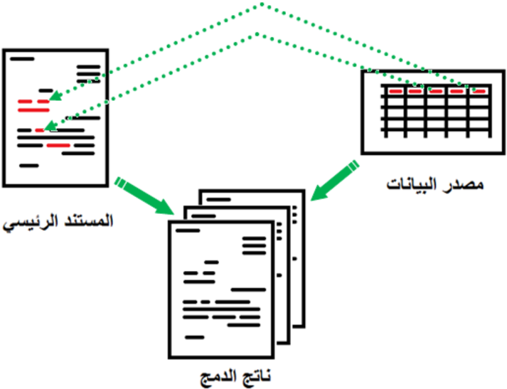

# الوحدة 10: دمج المراسلات في Word

## المجال المفاهيمي الثالث: المكتبية

**المستوى:** السنة الأولى ثانوي (1AS)  
**المدة الزمنية:** ساعتان (أسبوع واحد: ساعة نظرية + ساعة تطبيقية)  
**البرنامج المرجعي:** Microsoft Word وExcel في Microsoft 365 / Office 2021

---

## الأهداف التعلمية

في نهاية هذه الوحدة، يكون المتعلم قادرًا على أن:

1. يشرح مفهوم **دمج المراسلات** (Mail Merge) ومتى نحتاج إليه.
2. يميّز بين **المستند الرئيسي** (Main Document) و**مصدر البيانات** (Data Source) و**حقول الدمج** (Merge Fields).
3. يُنشئ مصدر بيانات (قاعدة بيانات بسيطة) في Excel أو مباشرة في Word.
4. يستعمل استمارة معلومات (رسالة بفراغات) كمستند رئيسي ويُدرج فيها حقول الدمج.
5. يعاين النتائج ويُنجز الدمج في مستند جديد أو للطباعة.
6. يستخرج **قائمة المدعوين** بنوع الدمج **دليل** (Directory).

---

## خريطة التعلم في حصتين

| الحصة | المرحلة | السؤال المركزي | ناتج التعلّم القابل للملاحظة |
|---|---|---|---|
| الأولى (نظرية) | الانطلاق (10 د) | كيف نكتب 30 دعوة دون أن نكتبها 30 مرة؟ | يقترح فكرة «رسالة واحدة + قائمة أسماء». |
| الأولى (نظرية) | بناء التعلمات (50 د) | ما مكوّنات الدمج؟ وكيف نربطها؟ | يُنجز دمجًا موجّهًا مع الأستاذ على 3 أسطر. |
| الثانية (تطبيقية) | النشاط التطبيقي (45 د) | كيف نُنتج الدعوات وقائمة المدعوين؟ | 10 دعوات مدمجة + قائمة مدعوين في جدول. |
| الثانية (تطبيقية) | التقويم (15 د) | هل أستطيع تفسير ما أنجزت؟ | يجيب عن التقويم الختامي وبطاقة الخروج. |

> **ملاحظة للأستاذ والتلميذ:** الأقسام المعلَّمة بـ **«إثراء»** خارج الأهداف الرسمية؛ تُنجز إن بقي وقت أو كعمل منزلي، ولا تدخل في التقويم.

---

## 1. وضعية الانطلاق: 30 وليًا ودعوة واحدة

قررت ثانويتك تنظيم **حفل تكريم المتفوقين** في نهاية الفصل الأول، وكلّفك المدير بكتابة دعوة لأولياء **30 تلميذًا**. نص الدعوة واحد، ولا يتغير فيها إلا: اسم التلميذ ولقبه وقسمه.

- **الحل التقليدي:** تكتب الدعوة، ثم تنسخها 30 مرة وتغيّر الاسم يدويًا في كل نسخة. النتيجة: وقت طويل، وأخطاء مؤكدة (اسم منسي، قسم خاطئ…).
- **الحل الذكي:** تكتب **دعوة واحدة** فيها أماكن فارغة، وتكتب **قائمة واحدة** بالأسماء، ثم تطلب من Word أن يُنتج 30 دعوة تلقائيًا. هذا هو **دمج المراسلات**.

> **سؤال للنقاش:** ماذا لو اكتشفنا خطأً في تاريخ الحفل بعد كتابة 30 نسخة يدويًا؟ وماذا لو استعملنا الدمج؟

---

## 2. مفهوم دمج المراسلات

**دمج المراسلات** (Mail Merge): خاصية في معالج النصوص تجمع بين **مستند نموذجي** فيه نص ثابت، و**قائمة بيانات** فيها معلومات متغيرة، لإنتاج **مستندات شخصية** لكل سطر من القائمة.

### أ. المكوّنات الثلاثة

| المكوّن | ماذا يحتوي؟ | مثال من وضعية الانطلاق |
|---|---|---|
| **المستند الرئيسي** (Main Document) | النص الثابت المشترك بين كل النسخ، مع أماكن للمعلومات المتغيرة | نص الدعوة: التاريخ، المكان، التوقيع… |
| **مصدر البيانات** (Data Source) | جدول: كل **عمود** حقل، وكل **سطر** سجل (شخص واحد) | جدول التلاميذ في Excel |
| **حقول الدمج** (Merge Fields) | روابط تُوضع في المستند الرئيسي وتشير إلى أعمدة مصدر البيانات | «الاسم»، «اللقب»، «القسم» |

**الناتج:** مستند ثالث (أو طباعة أو رسائل بريد) يحتوي نسخة لكل سجل.

### ب. مفردات قاعدة البيانات

- **الحقل** (Field): عمود واحد له اسم في السطر الأول، مثل `اللقب`.
- **السجل** (Record): سطر واحد يخص شخصًا واحدًا.
- **رأس العمود** (Column Header): اسم الحقل، يُكتب في **السطر الأول** فقط.

### ج. المستند الرئيسي هو «استمارة معلومات»

في وحدة القوالب أنجزت **استمارة معلومات**: نص ثابت وفراغات تُملأ. المستند الرئيسي هو الفكرة نفسها، لكن الفراغات **لا يملؤها شخص بيده** بل يملؤها Word من مصدر البيانات. لذلك يمكن أن تفتح استمارة أو قالبًا حفظته سابقًا وتستعمله مستندًا رئيسيًا.

### د. أنواع المستندات التي يُنتجها الدمج

نختارها من: **مراسلات (Mailings) › بدء دمج المراسلات (Start Mail Merge)**

| النوع | الاستعمال | الناتج |
|---|---|---|
| **رسائل** (Letters) | دعوات، شهادات، استدعاءات | صفحة لكل سجل |
| **رسائل البريد الإلكتروني** (E-mail Messages) | إرسال رسالة شخصية لكل مستلم | بريد لكل سجل |
| **مغلفات** (Envelopes) | كتابة العنوان على الظروف | ظرف لكل سجل |
| **تسميات** (Labels) | ملصقات الطاولات، ملصقات الكراريس | عدة ملصقات في الصفحة |
| **دليل** (Directory) | قوائم: قائمة المدعوين، قائمة القسم | كل السجلات متتالية في مستند واحد |

---

## 3. إنشاء مصدر البيانات (قاعدة البيانات)

### أ. قبل البدء: الأعمدة التي سنستعملها

نحدد الحقول **قبل** أي خطوة، لأن تغييرها لاحقًا يُفسد الربط:

| اسم الحقل | محتواه | مثال |
|---|---|---|
| `اللقب` | لقب التلميذ | بن علي |
| `الاسم` | اسم التلميذ | ياسين |
| `الجنس` | ذكر أو أنثى (بهذه الكتابة بالضبط) | ذكر |
| `القسم` | القسم | 1ع ت 1 |
| `الولاية` | ولاية الإقامة | البليدة |

**قواعد مصدر بيانات سليم:**

1. أسماء الحقول في **السطر الأول** فقط، دون خلايا مدمجة ودون سطر فارغ قبلها.
2. اسم الحقل قصير ودون مسافات (استعمل `_` عند الحاجة: `تاريخ_الميلاد`).
3. لا أسطر فارغة بين السجلات.
4. نكتب القيم المتكررة بالطريقة نفسها دائمًا: «أنثى» وليس مرة «أنثى» ومرة «انثى».

### ب. بيانات المثال (اكتبها كما هي)

| اللقب | الاسم | الجنس | القسم | الولاية |
|---|---|---|---|---|
| بن علي | ياسين | ذكر | 1ع ت 1 | الجزائر |
| حمادي | سارة | أنثى | 1ع ت 1 | البليدة |
| بوزيد | أمين | ذكر | 1آ 1 | تيبازة |
| قاسمي | مريم | أنثى | 1ع ت 2 | الجزائر |
| زروقي | إسحاق | ذكر | 1ع ت 2 | بومرداس |
| مسعودي | لينة | أنثى | 1آ 1 | البليدة |
| عيساوي | رياض | ذكر | 1ع ت 1 | تيبازة |
| خليفي | آية | أنثى | 1ع ت 2 | الجزائر |
| بلقاسم | نور الدين | ذكر | 1آ 1 | المدية |
| شريف | هبة | أنثى | 1ع ت 1 | بومرداس |

### ج. الطريقة المفضّلة اليوم: ورقة Excel

1. افتح Excel، ومصنفًا فارغًا.
2. اكتب أسماء الحقول في الخلايا `A1` إلى `E1`، ثم السجلات العشرة من السطر 2 إلى السطر 11.
3. احفظ الملف باسم `مدعوون_الحفل.xlsx` في مجلدك، ثم **أغلق Excel** (الملف المفتوح قد يرفض Word الاتصال به).

**لماذا Excel؟** لأن الإدارات تحتفظ أصلًا بقوائم التلاميذ في جداول Excel، فنستعملها مباشرة دون إعادة كتابة، ويسهل تعديلها وفرزها.

### د. الطريقة البديلة: كتابة قائمة جديدة في Word

1. **مراسلات (Mailings) › تحديد المستلمين (Select Recipients) › كتابة قائمة جديدة (Type a New List)**.
2. تظهر نافذة **قائمة عناوين جديدة** (New Address List) بأعمدة جاهزة بالإنجليزية (Title, First Name…). انقر **تخصيص الأعمدة** (Customize Columns).
3. احذف الأعمدة غير اللازمة بـ **حذف** (Delete)، وأضف أعمدتنا الخمسة بـ **إضافة** (Add)، ورتّبها بأزرار **نقل لأعلى / نقل لأسفل** (Move Up / Move Down)، ثم **موافق** (OK).
4. اكتب السجل الأول، ثم **إدخال جديد** (New Entry) لكل سجل موالٍ.
5. عند **موافق** (OK) يطلب Word حفظ القائمة: يحفظها كملف قاعدة بيانات (`.mdb`) في مجلد **مصادر البيانات الخاصة بي** (My Data Sources). احفظها باسم واضح.

---

## 4. تحضير المستند الرئيسي وربطه بمصدر البيانات

### أ. اكتب نص الدعوة (الجزء الثابت)

افتح مستندًا جديدًا في Word واكتب النص التالي، تاركًا الأماكن بين المعقوفتين [ ] فارغة:

> **ثانوية الأمير عبد القادر**  
> إلى وليّ أمر: [الاسم] [اللقب] — القسم: [القسم]  
> تحية طيبة وبعد،  
> يسرّ مدير الثانوية دعوتكم لحضور **حفل تكريم المتفوقين** للفصل الأول، يوم **الخميس 17 ديسمبر 2026** على الساعة **10:00** صباحًا بقاعة المحاضرات، تشجيعًا لمجهودات [الاسم] ونتائجه المتميزة.  
> حضوركم يسعدنا. — المدير

احفظه باسم `دعوة_رئيسية.docx`.

### ب. اختيار نوع الدمج وربط المصدر

1. **مراسلات (Mailings) › بدء دمج المراسلات (Start Mail Merge) › رسائل (Letters)**.
2. **تحديد المستلمين (Select Recipients) › استخدام قائمة موجودة (Use an Existing List)**.
3. انتقل إلى مجلدك واختر `مدعوون_الحفل.xlsx` ثم **فتح** (Open).
4. تظهر نافذة **تحديد جدول** (Select Table): اختر الورقة `Sheet1$` وتأكد من تفعيل خيار «الصف الأول من البيانات يحتوي على رؤوس أعمدة» (First row of data contains column headers)، ثم **موافق** (OK).

ظاهريًا لا يتغير شيء، لكن الأزرار الرمادية في تبويب **مراسلات** أصبحت مفعّلة: هذا دليل على نجاح الربط.

### ج. إدراج حقول الدمج

1. ضع مؤشر الكتابة مكان [الاسم] الأول (بعد حذف المعقوفتين).
2. **مراسلات (Mailings) › إدراج حقل دمج (Insert Merge Field)** (انقر السهم أسفل الزر) › اختر `الاسم`.
3. يظهر الحقل هكذا: **«الاسم»**. اكتب مسافة ثم أدرج `اللقب`.
4. كرّر العملية لـ `القسم` و`الاسم` الثاني في آخر الفقرة.

**ملاحظات مهمة:**

- لا تكتب علامتَي « » بيدك؛ الحقل الحقيقي يُدرج **فقط** من الزر. للتأكد: **تمييز حقول الدمج** (Highlight Merge Fields) يلوّن الحقول الحقيقية بالرمادي.
- المسافات وعلامات الوقف بين الحقول تكتبها أنت، لأن Word لا يضيفها.
- يمكن تنسيق الحقل مثل أي نص: حدّد «الاسم» واجعله **غامقًا**، فيظهر كل اسم غامقًا في كل الدعوات.

### د. معاينة النتائج

1. **مراسلات (Mailings) › معاينة النتائج (Preview Results)**: تُستبدل الحقول ببيانات السجل الأول (ياسين بن علي).
2. تنقّل بين السجلات بأسهم **السجل التالي / السابق** (Next / Previous Record) بجانب الزر، وراقب رقم السجل.
3. تحقق من سجلين أو ثلاثة على الأقل: المسافات، الأسماء المركّبة (نور الدين)، الاتجاه من اليمين إلى اليسار.
4. انقر **معاينة النتائج** مرة أخرى للعودة إلى عرض الحقول.

---

## 5. إنجاز الدمج: إنهاء ودمج

من **مراسلات (Mailings) › إنهاء ودمج (Finish & Merge)** نختار واحدًا من ثلاثة:

| الخيار | ماذا يحدث؟ | متى نستعمله؟ |
|---|---|---|
| **تحرير مستندات فردية** (Edit Individual Documents) | ينشئ مستندًا جديدًا يضم كل الدعوات | للمراجعة والحفظ قبل الطباعة (**الأنسب في المخبر**) |
| **طباعة مستندات** (Print Documents) | يرسل الدعوات مباشرة إلى الطابعة | عند التأكد التام من النتيجة |
| **إرسال رسائل بريد إلكتروني** (Send Email Messages) | يرسل كل دعوة إلى بريد صاحبها | يتطلب عمود بريد إلكتروني وبرنامج Outlook مضبوطًا |

**خطوات تحرير مستندات فردية:**

1. **إنهاء ودمج (Finish & Merge) › تحرير مستندات فردية (Edit Individual Documents)**.
2. في نافذة **دمج إلى مستند جديد** (Merge to New Document) اختر **الكل** (All) ثم **موافق** (OK). (يمكن اختيار السجل الحالي فقط، أو مجالًا «من… إلى…»).
3. يُفتح مستند جديد باسم مؤقت (`Letters1`) فيه **10 دعوات**، كل دعوة في صفحة. بين الدعوات وضع Word **فاصل مقطع (الصفحة التالية)** وهو ما درسته في وحدة المقاطع.
4. احفظ الناتج باسم `دعوات_مدمجة.docx`.

> **انتبه:** المستند الرئيسي **يبقى مرتبطًا** بملف Excel. لو عدّلت ملف Excel (أضفت تلميذًا)، يكفي فتح المستند الرئيسي وإعادة **إنهاء ودمج**؛ لا تعيد كتابة شيء. ولو نقلت ملف Excel إلى مجلد آخر، يسألك Word عن مكانه الجديد.

### أخطاء شائعة وحلولها

| ما تلاحظه | السبب المحتمل | الحل |
|---|---|---|
| أزرار تبويب مراسلات رمادية | لم يُربط مصدر البيانات | أعد **تحديد المستلمين** |
| أول تلميذ مفقود من الدعوات | أسماء الحقول ليست في السطر الأول | صحّح ملف Excel ثم أعد الربط |
| الاسم ملتصق باللقب | نسيت المسافة بين الحقلين | أضف مسافة بين «الاسم» و«اللقب» |
| Word يرفض فتح ملف Excel | الملف مفتوح في Excel | أغلق Excel ثم أعد المحاولة |

> **في LibreOffice:** يمر الدمج في Writer عبر **معالج دمج المراسلات** (Mail Merge Wizard) من قائمة **أدوات** (Tools)، ويجب أولًا تسجيل ملف الجدول كمصدر بيانات. المبدأ نفسه: مستند رئيسي + مصدر بيانات + حقول.

---

## 6. استخراج قائمة المدعوين: نوع الدمج «دليل» (Directory)

### أ. ما الفرق بين «رسائل» و«دليل»؟

- في **رسائل** (Letters): كل سجل في **صفحة مستقلة** ← 10 صفحات.
- في **دليل** (Directory): كل السجلات **متتالية في مستند واحد**، دون فواصل صفحات ← قائمة واحدة.

**القاعدة الذهبية للدليل:** كل ما تكتبه في المستند الرئيسي **يتكرر مع كل سجل**. لذلك نكتب فيه **سطرًا واحدًا** يمثّل مدعوًا واحدًا، ونضيف العنوان **بعد** الدمج.

### ب. الخطوات

1. أنشئ **مستندًا جديدًا فارغًا** (لا تستعمل مستند الدعوة) واحفظه باسم `قائمة_رئيسية.docx`.
2. **مراسلات (Mailings) › بدء دمج المراسلات (Start Mail Merge) › دليل (Directory)**.
3. **تحديد المستلمين (Select Recipients) › استخدام قائمة موجودة (Use an Existing List)** › الملف نفسه `مدعوون_الحفل.xlsx`.
4. اكتب سطرًا واحدًا بهذا الترتيب، مع الضغط على مفتاح `Tab` بين الحقول:  
   «اللقب» `Tab` «الاسم» `Tab` «القسم» `Tab` «الولاية» ثم `Enter` **مرة واحدة**.
5. **معاينة النتائج** (Preview Results) للتأكد من السجل الأول.
6. **إنهاء ودمج (Finish & Merge) › تحرير مستندات فردية (Edit Individual Documents) › الكل (All)**.

النتيجة: مستند جديد فيه **10 أسطر**، سطر لكل مدعو.

### ج. تحويل القائمة إلى جدول منظّم

1. في المستند الناتج، ضع المؤشر في بدايته واكتب سطر عنوان: `اللقب` `Tab` `الاسم` `Tab` `القسم` `Tab` `الولاية`.
2. فوقه اكتب عنوان الوثيقة: **قائمة المدعوين لحفل تكريم المتفوقين**.
3. حدّد الأسطر من سطر العنوان إلى آخر مدعو (دون عنوان الوثيقة).
4. **إدراج (Insert) › جدول (Table) › تحويل النص إلى جدول** (Convert Text to Table)، واختر الفصل عند **علامات الجدولة** (Tabs)، ثم **موافق**.
5. احذف السطر الفارغ الأخير إن ظهر، واحفظ باسم `قائمة_المدعوين.docx`.

> **خطأ شائع:** إذا كتبت عنوان القائمة في المستند الرئيسي للدليل، ستجده مكررًا 10 مرات في الناتج!

---

## 7. المغلفات والتسميات (لمحة)

- **مغلفات** (Envelopes): **بدء دمج المراسلات › مغلفات**، نختار مقاس الظرف، ثم نُدرج حقول العنوان في وسط الظرف ونكمل كالرسائل.
- **تسميات** (Labels): **بدء دمج المراسلات › تسميات**، نختار نوع الورق اللاصق، فيقسم Word الصفحة إلى خانات. نُدرج الحقول في **الخانة الأولى** فقط، ثم **تحديث التسميات** (Update Labels) لنسخها إلى باقي الخانات. مثال: ملصق على كل طاولة امتحان فيه الاسم واللقب ورقم التسجيل.

---

## 8. إثراء: تكييف النص حسب الجنس (قاعدة If…Then…Else)

**المشكلة:** نريد «ولي **التلميذ**» للذكور و«ولي **التلميذة**» للإناث، بدل «ولي أمر».

**الفكرة:** نجعل Word يختار **الكلمة كاملة** حسب قيمة الحقل `الجنس`. (لا نُضيف حرف «ة» وحده، لأن الحرف المنفصل يفقد الاتصال بالكلمة وتنسيقها ويكسر الكتابة العربية.)

1. في المستند الرئيسي احذف كلمتي «أمر:» وضع المؤشر بعد «إلى وليّ» ومسافة.
2. **مراسلات (Mailings) › قواعد (Rules) › If…Then…Else** (إذا… فإن… وإلا).
3. في النافذة املأ:
   - **اسم الحقل** (Field name): `الجنس`
   - **المقارنة** (Comparison): يساوي (Equal to)
   - **مقارنة بـ** (Compare to): `أنثى`
   - **إدراج هذا النص** (Insert this text): `التلميذة:`
   - **وإلا أدرج هذا النص** (Otherwise insert this text): `التلميذ:`
4. **موافق**، ثم **معاينة النتائج** وتنقّل بين سارة (التلميذة) وياسين (التلميذ).

**بنفس الطريقة:** «ونتائجه» / «ونتائجها» بقاعدة ثانية تضع الكلمة كاملة.

> **إذا ظهرت كلمة «التلميذ» عند تلميذة:** تحقق من كتابة «أنثى» في Excel وفي النافذة حرفًا بحرف (همزة، مسافة زائدة…). ولتنسيق نتيجة القاعدة، حدّدها وطبّق الخط المطلوب كأي نص.

---

## 9. إثراء: تصفية المستلمين وفرزهم

1. **مراسلات (Mailings) › تحرير قائمة المستلمين (Edit Recipient List)**.
2. **يدويًا:** أزل علامة الاختيار أمام السجلات التي لا تريد دمجها (مناسب لعدد صغير).
3. **بشرط:** انقر **تصفية** (Filter)، واختر الحقل `الولاية`، والمقارنة **يساوي** (Equal to)، والقيمة `البليدة` ← تبقى سجلات سارة ولينة فقط.
4. **الفرز:** انقر **فرز** (Sort) واختر الحقل `اللقب` تصاعديًا، فتخرج قائمة المدعوين مرتبة أبجديًا.
5. أعد **إنهاء ودمج**. لإلغاء التصفية: **تصفية › مسح الكل** (Clear All).

---

## نشاط تطبيقي: دعوة حفل التكريم وقائمة المدعوين

**الوضعية:** كلّفك مدير الثانوية بإعداد دعوات أولياء التلاميذ المتفوقين، وقائمة المدعوين التي سيستعملها المكلّف بالاستقبال يوم الحفل.

**العمل:** فرديًا (أو ثنائيًا إن قلّت الأجهزة) — **المدة:** 45 دقيقة — **الملفات:** في مجلد باسمك.

| المهمة | ما يجب إنجازه | مؤشر النجاح |
|---|---|---|
| 1 | إنشاء `مدعوون_الحفل.xlsx` بالحقول الخمسة والسجلات العشرة (الفقرة 3-ب) | رؤوس الأعمدة في السطر 1، و10 سجلات دون أسطر فارغة |
| 2 | كتابة نص الدعوة وحفظه `دعوة_رئيسية.docx` | النص الثابت كامل وصحيح الإملاء |
| 3 | ربط الدعوة بالمصدر وإدراج الحقول الأربعة | الحقول تظهر رمادية مع **تمييز حقول الدمج** |
| 4 | معاينة 3 سجلات على الأقل | المسافات سليمة، «نور الدين» يظهر كاملًا |
| 5 | الدمج إلى مستند جديد وحفظه `دعوات_مدمجة.docx` | 10 صفحات، صفحة لكل تلميذ |
| 6 | دمج «دليل» وتحويله إلى جدول `قائمة_المدعوين.docx` | عنوان واحد + جدول من 4 أعمدة و11 سطرًا (رأس + 10) |
| 7 (إثراء) | قاعدة «التلميذ/التلميذة» + فرز القائمة حسب اللقب | 5 دعوات بـ «التلميذة» و5 بـ «التلميذ»؛ القائمة تبدأ بـ «بلقاسم» |

**تسليم:** الملفات الأربعة (أو الخمسة) في مجلدك، مع الإجابة شفويًا: «ماذا أفعل لو أُضيف تلميذ جديد إلى القائمة؟».

---

## تقويم ختامي للوحدة

1. **المفهوم:** عرّف دمج المراسلات، واذكر مثالين من حياة المؤسسة يُستعمل فيهما.
2. **المكوّنات:** أكمل: المستند الرئيسي يحتوي على ……، ومصدر البيانات يحتوي على ……، وحقل الدمج هو …….
3. **قاعدة البيانات:** في جدول المثال، كم حقلًا وكم سجلًا؟ ولماذا يجب أن تكون أسماء الحقول في السطر الأول؟
4. **تشخيص خطأ:** كتب تلميذ «الاسم» بين علامتَي تنصيص بيده، فظهرت الكلمة «الاسم» نفسها في كل الدعوات. اشرح السبب والتصحيح.
5. **الدليل:** ما الفرق بين نوعي الدمج «رسائل» و«دليل»؟ ولماذا لا نكتب عنوان القائمة في المستند الرئيسي للدليل؟
6. **وضعية:** أُضيف ثلاثة تلاميذ إلى قائمة المتفوقين بعد إنجاز الدمج. ما أسرع طريقة للحصول على دعواتهم؟
7. **إنجاز (التقويم الرسمي):** اكتب دعوة موجهة لأعضاء نادي الإعلام الآلي (6 أشخاص على الأقل) لحضور اجتماع، أنجز الدمج، ثم استخرج قائمة المدعوين.

---

## بطاقة خروج سريعة (3–2–1)

- **3** مصطلحات تعلّمتها اليوم (مع معنى كل منها).
- **2** نوعان من نواتج الدمج يمكن أن تحتاجهما الثانوية.
- **1** خطوة ما زالت صعبة عليك في عملية الدمج.

---

### بطاقة إجابة مختصرة للأستاذ

1. **المفهوم:** خاصية تجمع مستندًا نموذجيًا ثابتًا مع قائمة بيانات لإنتاج مستند شخصي لكل سجل. أمثلة: استدعاءات الأولياء، شهادات التقدير، ملصقات طاولات الامتحان، كشوف/قوائم الأقسام.
2. **المكوّنات:** النص الثابت المشترك (مع أماكن الحقول) / جدول السجلات (أعمدة = حقول، أسطر = سجلات) / رابط في المستند الرئيسي يشير إلى عمود في مصدر البيانات ويُستبدل بقيمته عند الدمج.
3. **قاعدة البيانات:** 5 حقول و10 سجلات. يقرأ Word السطر الأول أسماءً للحقول؛ إن لم تكن فيه، صارت بيانات أول تلميذ أسماءَ حقول ولا يُدمج ذلك السجل.
4. **تشخيص خطأ:** الكلمة مكتوبة نصًا عاديًا وليست حقلًا مرتبطًا. التصحيح: حذفها وإدراج الحقل من **إدراج حقل دمج**، والتحقق بـ **تمييز حقول الدمج**.
5. **الدليل:** «رسائل» تضع كل سجل في صفحة مستقلة (فاصل مقطع بين السجلات)، و«دليل» يضع السجلات متتالية في مستند واحد. كل ما في المستند الرئيسي يتكرر مع كل سجل، فالعنوان سيتكرر 10 مرات؛ لذا يضاف بعد الدمج.
6. **وضعية:** إضافة الثلاثة إلى ملف Excel وحفظه، ثم فتح المستند الرئيسي و**إنهاء ودمج** من جديد (ويمكن بالتصفية أو بمربعات الاختيار دمج الثلاثة الجدد فقط).
7. **الإنجاز — شبكة تصحيح مقترحة (10 ن):** مصدر بيانات سليم (رؤوس + 6 سجلات على الأقل) 2 ن؛ مستند رئيسي بنص ثابت صحيح 1 ن؛ حقلان على الأقل مُدرجان بشكل صحيح 2 ن؛ ناتج دمج «رسائل» كامل 2 ن؛ قائمة مدعوين بنوع «دليل» بعنوان واحد 2 ن؛ تسمية الملفات وحفظها 1 ن.

---

## معجم المصطلحات

| المصطلح | العربية | الشرح المختصر |
|---|---|---|
| Mail Merge | دمج المراسلات | إنتاج مستندات شخصية من مستند نموذجي وقائمة بيانات |
| Main Document | المستند الرئيسي | المستند الذي يحمل النص الثابت وحقول الدمج |
| Data Source | مصدر البيانات | الجدول الذي يحمل المعلومات المتغيرة (Excel، قائمة Word…) |
| Merge Field | حقل الدمج | رابط في المستند الرئيسي يُستبدل بقيمة من مصدر البيانات |
| Field | حقل | عمود في قاعدة البيانات له اسم |
| Record | سجل | سطر يخص شخصًا أو عنصرًا واحدًا |
| Recipients | المستلمون | الأشخاص الذين تُنتج لهم المستندات |
| Preview Results | معاينة النتائج | عرض الحقول ببيانات سجل حقيقي قبل الدمج |
| Finish & Merge | إنهاء ودمج | تنفيذ الدمج نحو مستند جديد أو طابعة أو بريد |
| Directory | دليل | نوع دمج يضع كل السجلات متتالية في مستند واحد (قائمة) |
| Labels | تسميات | ملصقات متعددة في الصفحة الواحدة |
| Envelopes | مغلفات | طباعة العنوان على الظروف البريدية |
| Filter / Sort | تصفية / فرز | اختيار السجلات حسب شرط / ترتيبها |
