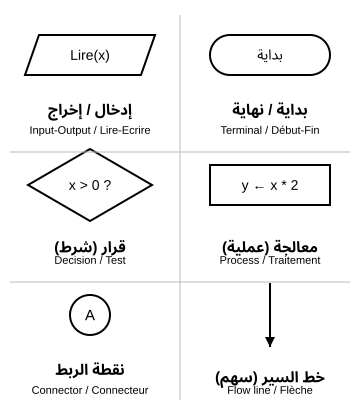
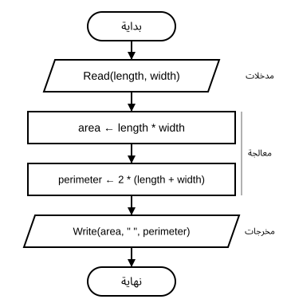
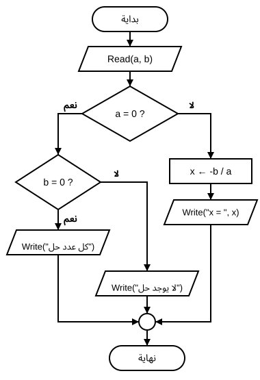
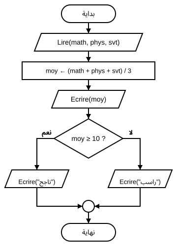
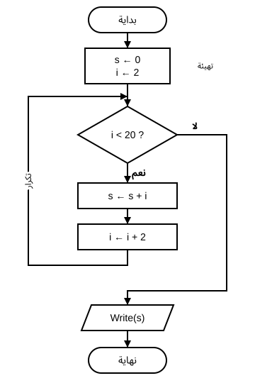

# الوحدة 15: المخطط النسقي (الانسيابي)

## المجال المفاهيمي الثاني: مقدمة في البرمجة

**المستوى:** السنة الأولى ثانوي (1AS)  
**المدة الزمنية:** ساعتان (ساعة نظرية مع القسم + ساعة تطبيقية بالأفواج)

---

## الأهداف التعلمية

في نهاية هذه الوحدة، يكون المتعلم قادرًا على أن:

1. يحدد عناصر مشكلة بسيطة: **المدخلات** و**المعالجة** و**المخرجات**.
2. يعرّف المخطط النسقي (Flowchart / *Organigramme*) ويذكر فائدته.
3. يميّز بين الرموز الأساسية الستة ويستعمل كل رمز في مكانه.
4. يرسم مخططًا نسقيًا متسلسلًا لمسألة حسابية بسيطة (مساحة ومحيط مستطيل).
5. يرسم مخططًا فيه **قرار** بفرعين «نعم / لا» (معادلة من الدرجة الأولى، معدل).
6. ينفّذ مخططًا بيده بقيم تجريبية، ويتتبع **حلقة تكرار** بسيطة في جدول.

---

## خريطة التعلم في أسبوع واحد (ساعتان)

| المرحلة | السؤال المركزي | ناتج التعلّم القابل للملاحظة |
|---|---|---|
| الانطلاق (10 د) | كيف نشرح لآلة لا تفكر طريقة تحضير الشاي؟ | يرتب خطوات حل مشكلة يومية. |
| بناء التعلمات (40 د) | ما عناصر المشكلة؟ وما رموز المخطط؟ | يحلل مسألة ويرسم مخطط المستطيل والمعادلة. |
| التطبيق الموجّه (25 د) | كيف نضيف شرطًا وتكرارًا؟ | يرسم مخطط المعدل ويتتبع حلقة الأعداد الزوجية. |
| الورشة والتقويم (45 د) | هل يعمل مخطط زميلي فعلًا؟ | يرسم مخططًا وينفّذ مخطط زميله بقيم تجريبية. |

> **تحدٍّ قبل البداية:** الحاسوب ينفّذ مليارات العمليات في الثانية، لكنه لا يعرف كيف يحسب معدلك ما لم يشرح له إنسان ذلك **خطوة بخطوة**. في هذه الوحدة ستتعلم لغة يفهمها كل مبرمج في العالم قبل أن يكتب سطرًا واحدًا: **الرسم بالأشكال**.

---

## 1. من مشكلة يومية إلى حل منظّم

### أ. ما هي المشكلة (المسألة)؟

**المشكلة** (Problem / *Problème*) وضعية نريد الوصول فيها إلى نتيجة، ولا نعرف الطريق إليها مباشرة. حلها يعني تحديد **خطوات مرتبة** توصلنا من المعطيات إلى النتيجة.

مثال من الحياة: **تحضير كأس شاي**.

1. نضع الماء في الإبريق ونسخّنه.
2. ننتظر حتى يغلي الماء.
3. نضيف الشاي والسكر ونترك المزيج قليلًا.
4. نصبّ الشاي في الكأس.

لو بدّلنا ترتيب الخطوتين 3 و1، لن نحصل على شاي جيد. **الترتيب جزء من الحل.**

### ب. عناصر المشكلة الثلاثة

قبل أي حل، نجيب عن ثلاثة أسئلة:

| العنصر | السؤال | مثال الشاي | مثال المعدل الفصلي |
|---|---|---|---|
| **المدخلات** (Inputs / *Entrées*) | ماذا أعطي في البداية؟ | الماء، الشاي، السكر | علامات المواد |
| **المعالجة** (Processing / *Traitement*) | ماذا أفعل بالمدخلات؟ | التسخين، الخلط، الانتظار | الجمع ثم القسمة |
| **المخرجات** (Outputs / *Sorties*) | ماذا أريد في النهاية؟ | كأس شاي | المعدل |

> **قاعدة ذهبية:** «فهم السؤال نصف الجواب». نبدأ دائمًا بالمخرجات: ماذا يُطلب مني؟ ثم نسأل: ماذا أحتاج لأحصل عليه؟

### ج. تطبيق سريع (3 دقائق)

حدّد المدخلات والمعالجة والمخرجات في المسائل الآتية:

1. حساب ثمن 3 كرّاسات سعر الواحدة 60 دج. (المخرج المنتظر: 180 دج)
2. تحويل مسافة من الكيلومتر إلى المتر. (مثال: 2.5 كم ← 2500 م)
3. معرفة هل عدد ما موجب أم سالب. (مثال: -4 ← سالب)

---

## 2. المخطط النسقي

### أ. تعريف

**المخطط النسقي** (Flowchart / *Organigramme*)، ويسميه الكتاب المدرسي أيضًا **المخطط الانسيابي**، هو **تمثيل بياني** لخطوات حل مشكلة من البداية إلى النهاية، باستعمال **أشكال هندسية اصطلاحية** تربطها **أسهم** تبيّن اتجاه سير الحل.

### ب. لماذا نرسم قبل أن نبرمج؟

- الرسم **يُرى بنظرة واحدة**: نكتشف الخطوة الناقصة أو المكررة بسرعة.
- الرموز **عالمية**: يفهمها مبرمج في الجزائر أو اليابان.
- المخطط **مستقل عن لغة البرمجة**: نرسمه مرة، ثم نكتبه بأي لغة.
- يستعمله المهندسون أيضًا لوصف عمل الآلات: الصراف الآلي، إشارة المرور، الباب الآلي.

### ج. خطوات إنشاء مخطط نسقي

1. **تحديد المشكلة:** ما المطلوب بالضبط؟
2. **تحليل عناصرها:** المدخلات، المعالجة، المخرجات.
3. **الرسم:** نرتب الخطوات بالرموز الاصطلاحية من «بداية» إلى «نهاية».
4. **الاختبار:** ننفذ المخطط بأيدينا بقيم تجريبية ونتحقق من النتيجة.

---

## 3. رموز المخطط النسقي



| الرمز (وصف الشكل) | الاسم | الدور | مثال داخله |
|---|---|---|---|
| مستطيل بزوايا مستديرة (بيضوي) | بداية / نهاية (Terminal) | أول المخطط وآخره | `بداية` |
| متوازي أضلاع مائل | إدخال / إخراج (Input/Output) | قراءة معطى أو إظهار نتيجة | `Lire(x)` |
| مستطيل | معالجة (Process) | حساب أو إسناد قيمة | `y ← x * 2` |
| معيّن بمخرجين | قرار (Decision) | سؤال جوابه نعم أو لا | `x > 0 ?` |
| خط ينتهي برأس سهم | خط السير (Flow line) | يربط الرموز ويبيّن الاتجاه | ↓ |
| دائرة صغيرة | نقطة الربط (Connector) | تجمع عدة مسارات أو تصل جزأين | `A` |

**كيف نقرأ ما بداخل الرموز؟**

- `Lire(x)`: «اقرأ x»، أي يُدخل المستخدم قيمة x.
- `Ecrire(y)`: «اكتب y»، أي تظهر قيمة y على الشاشة.
- `y ← x * 2`: «يُسند إلى y» ناتج x × 2. السهم `←` يعني **ضع في**.
- المقارنة: `=  ≠  <  >  ≤  ≥`، والضرب `*` والقسمة `/`.

> هذه الكلمات (`Lire`، `Ecrire`، `←`) هي نفسها التي سنستعملها في كتابة الخوارزميات في الوحدة 16.

### قواعد الرسم الصحيح

1. للمخطط **بداية واحدة** و**نهاية واحدة**.
2. السير من **الأعلى إلى الأسفل** في الغالب، وكل سهم له رأس.
3. لكل رمز معالجة أو إدخال/إخراج **سهم داخل وسهم خارج**.
4. المعيّن **سهم داخل وسهمان خارجان** مكتوب عليهما «نعم» و«لا».
5. **لا نحسب قيمة قبل إدخالها**: الإدخال يسبق المعالجة دائمًا.

---

## 4. المثال الأول: مساحة ومحيط مستطيل

**المسألة:** نريد حساب مساحة مستطيل ومحيطه بمعرفة طوله وعرضه.

### أ. تحليل عناصر المسألة

| العنصر | المحتوى |
|---|---|
| المدخلات | الطول `long` والعرض `larg` |
| المعالجة | `surface ← long * larg` ثم `perimetre ← 2 * (long + larg)` |
| المخرجات | المساحة `surface` والمحيط `perimetre` |

### ب. المخطط النسقي



هذا **مخطط متسلسل** (Sequential): تُنفّذ الخطوات واحدة بعد الأخرى دون أي اختيار.

### ج. التنفيذ اليدوي

نجرب بالقيم `long = 5` و`larg = 3`:

| الخطوة | long | larg | surface | perimetre | Ecrire |
|---|---|---|---|---|---|
| `Lire(long, larg)` | 5 | 3 | | | |
| `surface ← long * larg` | 5 | 3 | 15 | | |
| `perimetre ← 2 * (long + larg)` | 5 | 3 | 15 | 16 | |
| `Ecrire(surface, " ", perimetre)` | 5 | 3 | 15 | 16 | 15 16 |

---

## 5. المثال الثاني: معادلة من الدرجة الأولى

**المسألة:** حل المعادلة `ax + b = 0` حيث `a` و`b` عددان حقيقيان يُدخلهما المستخدم.

### أ. التحليل الرياضي

- إذا كان `a ≠ 0`: للمعادلة حل وحيد `x = -b / a`.
- إذا كان `a = 0` و`b = 0`: تصبح `0 = 0`، فكل عدد حقيقي حل.
- إذا كان `a = 0` و`b ≠ 0`: تصبح `b = 0` وهذا خطأ، فلا يوجد حل.

> لا يمكن القسمة على صفر، ولهذا **نختبر قيمة a أولًا** قبل حساب `-b / a`.

### ب. رمز القرار (الشرط)

المعيّن يطرح **سؤالًا** جوابه نعم أو لا، ويتفرّع المخطط إلى طريقين. هنا نحتاج قرارين: الأول على `a`، والثاني على `b`.



تلتقي الطرق الثلاثة في **نقطة الربط** قبل «نهاية»، فيبقى للمخطط نهاية واحدة.

### ج. اختبار الحالات الثلاث

| a | b | الطريق المتّبع | المخرج المنتظر |
|---|---|---|---|
| 2 | -6 | `a = 0 ?` لا | `x = 3` |
| 0 | 0 | `a = 0 ?` نعم ← `b = 0 ?` نعم | كل عدد حل |
| 0 | 5 | `a = 0 ?` نعم ← `b = 0 ?` لا | لا يوجد حل |

> **نصيحة المبرمج:** اختبر **كل فرع** من المخطط بقيمة واحدة على الأقل؛ الفرع الذي لم تختبره قد يخفي خطأ.

---

## 6. المثال الثالث: معدل المواد الأساسية

**المسألة:** حساب معدل ثلاث مواد أساسية (الرياضيات، العلوم الفيزيائية، علوم الطبيعة والحياة) بمعاملات متساوية، ثم إظهار «ناجح» إذا كان المعدل **أكبر من أو يساوي 10**، و«راسب» في غير ذلك.

| العنصر | المحتوى |
|---|---|
| المدخلات | `math`، `phys`، `svt` |
| المعالجة | `moy ← (math + phys + svt) / 3` ثم الاختبار `moy ≥ 10` |
| المخرجات | المعدل `moy` والملاحظة |



| math | phys | svt | moy | المخرج |
|---|---|---|---|---|
| 12 | 9 | 15 | 12 | 12 ناجح |
| 8 | 10 | 9 | 9 | 9 راسب |
| 10 | 10 | 10 | 10 | 10 ناجح |

> **انتبه:** عتبة النجاح في الجزائر هي **10 من 20**، والشرط `moy ≥ 10` (وليس `moy > 10`)، لأن من تحصّل على 10 بالضبط ناجح. الحالة الحدّية (10) هي أهم قيمة تختبرها.

---

## 7. التكرار: مجموع الأعداد الزوجية الأقل من 20

### أ. الفكرة

المطلوب: `2 + 4 + 6 + … + 18`. يمكن كتابة الأعداد التسعة واحدًا واحدًا، لكن لو طُلب مجموع الأعداد الزوجية الأقل من 1000، فسنحتاج إلى كتابة 499 عددًا!

الحل: نكتب العملية **مرة واحدة** ونجعل المخطط **يعود إلى الوراء** ليكررها. هذا هو **التكرار** أو **الحلقة** (Loop / *Boucle*):

- `s` يجمع النتيجة، ويبدأ من `0`.
- `i` هو العدد الزوجي الحالي، ويبدأ من `2` ويزيد بـ `2` في كل دورة.
- القرار `i < 20 ?` يحدد متى نتوقف.

### ب. المخطط النسقي



السهم الذي يصعد على اليسار هو **سهم العودة**: ما دام الجواب «نعم»، نعيد الجمع والزيادة.

### ج. جدول التتبع

| الدورة | `i < 20 ?` | s | i | Ecrire |
|---|---|---|---|---|
| التهيئة | — | 0 | 2 | |
| 1 | نعم | 2 | 4 | |
| 2 | نعم | 6 | 6 | |
| 3 | نعم | 12 | 8 | |
| 4 | نعم | 20 | 10 | |
| 5 | نعم | 30 | 12 | |
| 6 | نعم | 42 | 14 | |
| 7 | نعم | 56 | 16 | |
| 8 | نعم | 72 | 18 | |
| 9 | نعم | 90 | 20 | |
| الخروج | لا | 90 | 20 | 90 |

**المخرج:** `90`. (العدد 0 زوجي أيضًا، لكن إضافته لا تغيّر المجموع.)

**أخطاء شائعة:**

- نسيان `i ← i + 2`: تبقى `i = 2` ويدور المخطط **بلا نهاية**.
- كتابة `i ≤ 20`: يُضاف 20 فيصبح المجموع 110 بدل 90.
- نسيان `s ← 0` في البداية: نجمع على قيمة مجهولة.

---

## 8. أدوات الرسم (إثراء)

| الأداة | الاستعمال | ملاحظة |
|---|---|---|
| الورقة والقلم | الطريقة الأولى والأسرع | المسودة قبل أي برنامج |
| draw.io (diagrams.net) | رسم مخطط نظيف وطباعته | مجاني، في المتصفح أو كبرنامج مثبّت |
| Flowgorithm | تشغيل المخطط وإدخال القيم ورؤية النتيجة | مجاني لنظام Windows، واجهته بالإنجليزية |

> في draw.io: من قائمة الأشكال اختر مجموعة **Flowchart**، واسحب الرموز ثم اربطها بالأسهم. وفي Flowgorithm تختلف بعض الأشكال قليلًا عن الكتاب، فاعتمد دائمًا رموز هذا الدرس في الامتحان.

---

## نشاط تطبيقي: ارسم – بادل – نفّذ

**الوضعية:** فريقان من المبرمجين يتبادلان الحلول. لا يُقبل أي مخطط قبل أن ينفّذه زميل آخر بيده ويحصل على النتيجة الصحيحة.

**العمل:** في ثنائيات — **المدة:** 30 دقيقة — **الوسيلة:** ورقة، أو draw.io إن توفر.

| المهمة | ما يجب إنجازه | مؤشر النجاح |
|---|---|---|
| 1 | تحليل المسألة المعطاة في جدول (مدخلات، معالجة، مخرجات) | الجدول مكتمل ومتّفق عليه |
| 2 | رسم المخطط النسقي بالرموز الصحيحة | بداية ونهاية واحدة، كل سهم برأس |
| 3 | تبادل المخطط مع الثنائي المجاور | — |
| 4 | تنفيذ مخطط الزملاء بيدك بالقيم التجريبية | النتيجة مطابقة للمخرج المنتظر |
| 5 | كتابة ملاحظة واحدة لتحسين مخطط الزملاء | ملاحظة دقيقة (رمز، سهم، شرط) |

**المسائل الموزعة (لكل ثنائي مسألة):**

| المسألة | قيمة تجريبية | المخرج المنتظر |
|---|---|---|
| مساحة ومحيط دائرة (`PI = 3.14`) | `r = 5` | `78.5` و `31.4` |
| تحويل درجة الحرارة: `F ← C * 9 / 5 + 32` | `C = 25` | `77` |
| أكبر عددين | `7` و `12` | `12` |
| عدد زوجي أم فردي (`n mod 2 = 0 ?`) | `14` ثم `7` | `زوجي` ثم `فردي` |

> `n mod 2` هو **باقي** قسمة n على 2: يساوي 0 إذا كان n زوجيًا.

---

## تقويم ختامي للوحدة

1. **عناصر المشكلة:** حدّد المدخلات والمعالجة والمخرجات لمسألة: «حساب ثمن `q` قطعة سعر الواحدة `p`». مثال: `q = 4`، `p = 25` ← `100`.
2. **الرموز:** ما الرمز المناسب لكل من: `Lire(n)`، `s ← s + n`، `n > 0 ?`، `Ecrire(s)`؟
3. **اكتشف الخطأ:** مخطط يحسب `surface ← long * larg` ثم يقرأ `Lire(long, larg)`. ما الخطأ؟ وكيف نصلحه؟
4. **القرار:** ارسم مخططًا يقرأ المعدل السنوي ويكتب «ناجح» إذا كان `≥ 10` و«راسب» في غير ذلك. اختبره بـ `10` (ناجح) و`9.5` (راسب).
5. **التكرار:** عدّل مخطط الأعداد الزوجية ليحسب مجموع **الأعداد الفردية** الأقل من 20. المخرج المنتظر: `100`.
6. **التتبع:** في مخطط الأعداد الزوجية، كم مرة يُنفَّذ الرمز `s ← s + i`؟ وكم مرة يُطرح السؤال `i < 20 ?`؟

---

## بطاقة خروج سريعة (3–2–1)

قبل مغادرة الحصة، اكتب في دقيقة واحدة:

- **3** رموز من المخطط النسقي مع دور كل منها.
- **2** خطآن يجب تجنبهما عند رسم مخطط.
- **1** سؤال ما زال لديك حول القرار أو التكرار.

يستعملها الأستاذ لبداية الحصة التالية: يُجيب عن السؤال المتكرر ويصحّح المفهوم الخاطئ الشائع.

---

### بطاقة إجابة مختصرة للأستاذ

1. **عناصر المشكلة:** المدخلات `q` و`p`؛ المعالجة `t ← q * p`؛ المخرج `t`. مع `q = 4` و`p = 25` نحصل على `100`.
2. **الرموز:** `Lire(n)` و`Ecrire(s)` في متوازي أضلاع؛ `s ← s + n` في مستطيل؛ `n > 0 ?` في معيّن.
3. **الخطأ:** الحساب قبل الإدخال، فالمتغيران بلا قيمة. الإصلاح: نضع `Lire(long, larg)` قبل رمز المعالجة.
4. **القرار:** بداية ← `Lire(moy)` ← معيّن `moy ≥ 10 ?` ← نعم: `Ecrire("ناجح")` / لا: `Ecrire("راسب")` ← نقطة ربط ← نهاية. القيمة 10 تعطي «ناجح» لأن الشرط `≥`.
5. **الفردية:** نغيّر التهيئة فقط إلى `i ← 1` ونُبقي `i ← i + 2`: `1 + 3 + … + 19 = 100`.
6. **التتبع:** `s ← s + i` يُنفَّذ **9 مرات**؛ السؤال يُطرح **10 مرات** (9 بجواب نعم + مرة بجواب لا).

---

## من المخطط إلى الخوارزمية (تمهيد للوحدة 16)

المخطط النسقي **يُرى**، والخوارزمية **تُكتب**. في الوحدة 16 سنكتب الحل نفسه نصًّا، سطرًا بسطر، بكلمات قريبة جدًا مما وضعناه داخل الرموز. هذه لمحة عن مخطط المستطيل مكتوبًا خوارزمية:

```text
Algorithme Rectangle
Var
    long, larg, surface, perimetre : Réel
Début
    Lire(long, larg)
    surface ← long * larg
    perimetre ← 2 * (long + larg)
    Ecrire(surface, " ", perimetre)
Fin
```

قارن: كل رمز في المخطط أصبح سطرًا، و«بداية / نهاية» أصبحتا `Début` و`Fin`.

---

## معجم المصطلحات

| المصطلح | العربية | الشرح المختصر |
|---|---|---|
| Problem / *Problème* | المشكلة (المسألة) | وضعية نبحث لها عن حل بخطوات مرتبة |
| Inputs / *Entrées* | المدخلات | المعطيات التي نبدأ بها |
| Processing / *Traitement* | المعالجة | العمليات المطبقة على المدخلات |
| Outputs / *Sorties* | المخرجات | النتائج المطلوبة |
| Flowchart / *Organigramme* | المخطط النسقي (الانسيابي) | تمثيل بياني لخطوات الحل بالرموز |
| Terminal | بداية / نهاية | الرمز البيضوي في طرفي المخطط |
| Decision / *Test* | القرار (الشرط) | معيّن بسؤال جوابه نعم أو لا |
| Connector / *Connecteur* | نقطة الربط | دائرة تجمع المسارات |
| Assignment / *Affectation* | الإسناد `←` | وضع قيمة في متغير |
| Loop / *Boucle* | الحلقة (التكرار) | إعادة خطوات ما دام الشرط صحيحًا |
| Trace table | جدول التتبع | جدول قيم المتغيرات خطوة بخطوة |
